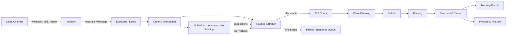
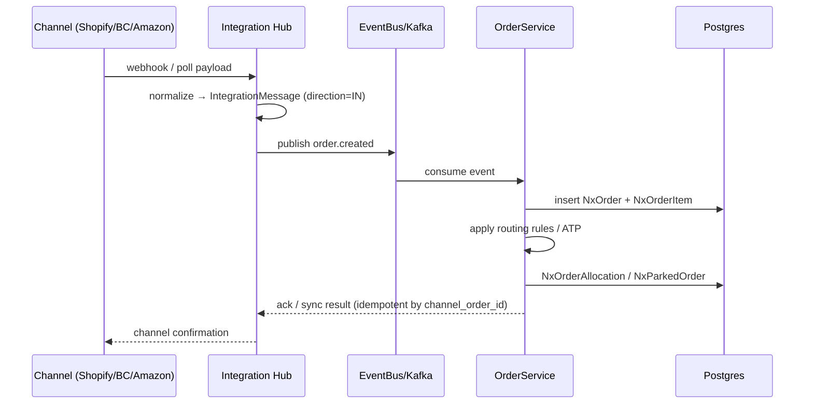
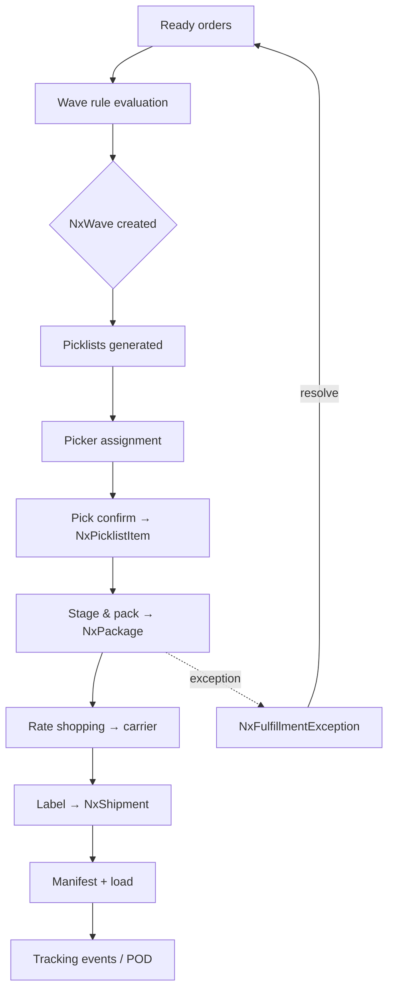
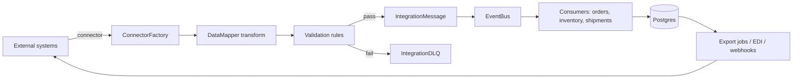
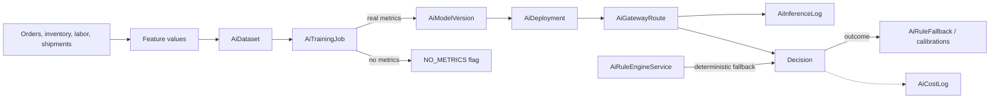
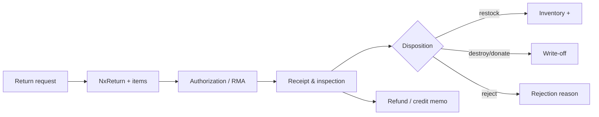
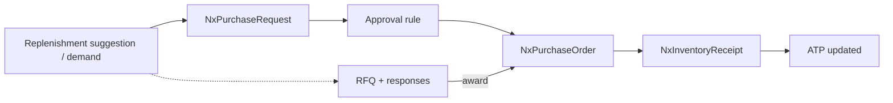
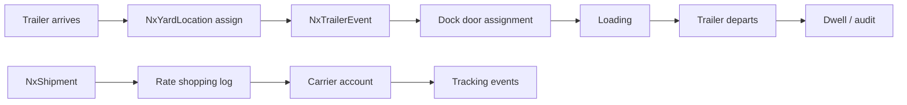

# NEXUS — Deployment Guide, System Design & Flow Diagrams

> **One document, three views of the Nexus OMS & Supply Chain Platform:**
> 1. **System Design** — services, tech stack, layering, integrations, AI, security, data model
> 2. **Flow Diagrams** — end-to-end data movement in Mermaid notation
> 3. **Deployment Guide** — every way to run Nexus, from a laptop to production cloud clusters
>
> Consolidated from the canonical sources: [`docs/ARCHITECTURE.md`](docs/ARCHITECTURE.md) ·
> [`docs/02-TECHNICAL-ARCHITECTURE.md`](docs/02-TECHNICAL-ARCHITECTURE.md) ·
> [`docs/05-DATA-FLOW.md`](docs/05-DATA-FLOW.md) · [`docs/DEPLOYMENT.md`](docs/DEPLOYMENT.md)

---

## Table of Contents

**Part I — System Design**
1. [Platform Overview](#1-platform-overview)
2. [Service Architecture](#2-service-architecture)
3. [Technology Stack](#3-technology-stack)
4. [Backend Layering](#4-backend-layering)
5. [Integration Hub (iPaaS-lite)](#5-integration-hub-ipaas-lite)
6. [AI / ML Platform](#6-ai--ml-platform)
7. [Security Model](#7-security-model)
8. [Data Model](#8-data-model)
9. [Event Streaming (Kafka)](#9-event-streaming-kafka)

**Part II — Flow Diagrams**
10. [The Big Picture](#10-the-big-picture-order--dispatch--analytics)
11. [Order Intake Flow](#11-order-intake-flow)
12. [Fulfillment Flow (wave → ship)](#12-fulfillment-flow-wave--ship)
13. [Integration Hub Data Flow](#13-integration-hub-data-flow-ipaas)
14. [AI Platform Data Flow](#14-ai-platform-data-flow)
15. [Returns Data Flow](#15-returns-data-flow)
16. [Procurement Data Flow](#16-procurement-data-flow)
17. [Yard & Shipping Data Flow](#17-yard--shipping-data-flow)

**Part III — Deployment Guide**
18. [Prerequisites](#18-prerequisites)
19. [Local Deployment](#19-local-deployment)
20. [Single-Server Deployment](#20-single-server-deployment)
21. [Cloud Platform Deployment](#21-cloud-platform-deployment)
22. [Environment Matrix (Dev / UAT / Prod)](#22-environment-matrix-dev--uat--prod)
23. [Sizing by Record Volume](#23-sizing-by-record-volume)
24. [Security Hardening](#24-security-hardening)
25. [TLS / Reverse Proxy](#25-tls--reverse-proxy)
26. [Backup & Disaster Recovery](#26-backup--disaster-recovery)
27. [Troubleshooting](#27-troubleshooting)

---

# Part I — System Design

## 1. Platform Overview

Nexus is a **full-stack Order Management System (OMS)** and supply chain platform. It covers the entire order lifecycle:

```
Order Creation → Order Approval → Allocation → Picking → Packing →
Shipping → Delivery → Returns → Refunds → Analytics
```

Plus supporting functions:

- **Inventory management** (multi-warehouse, zones, bins, cycle counts)
- **Procurement** (suppliers, purchase orders, ASNs, receiving)
- **Carrier management** (rate cards, rate shopping, labels, manifests)
- **Integrations** (Shopify, BigCommerce, Amazon, Walmart, eBay, EDI)
- **AI / ML** (order routing, demand forecasting, inventory optimization, box optimization, pick-pack-ship)
- **Analytics & reporting** (dashboards, billing, invoicing)
- **B2B / client portal** (B2B ordering, client self-service)

> 🧒 **Kid translation:** Think of Nexus as a restaurant with 4 floors — the counter (frontend screens), the kitchen (backend brain), the pantry (database + caches), and the robot friends (AI services) — with a security guard (RBAC) at the door.

---

## 2. Service Architecture

The Docker stack consists of **9 services**:

| Service      | Container        | Port  | Description                                   |
|--------------|------------------|-------|-----------------------------------------------|
| PostgreSQL   | `nexus-postgres` | 5433  | Primary database (pgvector/pg16)              |
| Redis        | `nexus-redis`    | 6379  | Cache & sessions                              |
| Kafka        | `nexus-kafka`    | 9092  | Event streaming / order lifecycle             |
| Backend      | `nexus-backend`  | 8080  | Spring Boot 3 OMS API (`/api/v1`)             |
| Frontend     | `nexus-frontend` | 80    | React + Vite SPA (nginx)                      |
| AI Ops       | `nexus-ai-ops`   | 5000  | Python ML — order routing                     |
| AI Intel     | `nexus-ai-intel` | 5001  | Python ML — demand & inventory                |
| Prometheus   | `nexus-prometheus`| 9090 | Metrics scraping                              |
| Grafana      | `nexus-grafana`  | 3001  | Dashboards & alerting                         |

```
                    ┌─────────────────────────────────────────────┐
                    │              FRONTEND (nginx :80)           │
                    │         React SPA + /api proxy              │
                    └───────────────┬─────────────────────────────┘
                                    │ /api/v1
                    ┌───────────────▼─────────────────────────────┐
                    │              BACKEND (Spring :8080)         │
                    │  Auth · Orders · Inventory · Shipments      │
                    │  Returns · Analytics · Integrations · AI    │
                    └───┬────────┬────────┬──────────┬────────────┘
                        │        │        │          │
              ┌─────────▼──┐ ┌───▼──┐ ┌───▼─────┐ ┌──▼──────────┐
              │ POSTGRES   │ │REDIS │ │ KAFKA   │ │ AI OPS      │
              │ pgvector   │ │cache │ │ events  │ │ AI INTEL    │
              │ :5433      │ │:6379 │ │ :9092   │ │ :5000/:5001 │
              └────────────┘ └──────┘ └─────────┘ └─────────────┘
                    ┌───────────────┬─────────────────────────────┐
                    │  PROMETHEUS   │        GRAFANA              │
                    │  :9090        │        :3001                │
                    └───────────────┴─────────────────────────────┘
```

**Key design points:**

- All secrets come from `.env` (gitignored) — **never** hardcoded.
- Named volumes persist data across container restarts.
- `restart: unless-stopped` on every service for auto-recovery.
- Backend waits for postgres/redis healthy before starting (`depends_on`).
- `SPRING_PROFILES_ACTIVE=prod` enables hardened production config.

### 2.1 Backend modules (Spring Boot 3, Java 17)

The core OMS API serves `/api/v1/**`:

| Module | Endpoints |
|--------|-----------|
| Auth & RBAC | `/auth`, `/rbac`, `/users` |
| Orders | `/orders`, `/order-approvals`, `/parked-orders`, `/order-routing` |
| Inventory | `/inventory`, `/inventory-receipts`, `/cycle-counts`, `/replenishment` |
| Fulfillment | `/picking`, `/packing`, `/shipments`, `/manifests`, `/labels` |
| Returns | `/returns`, `/return-finance` |
| Carriers | `/carriers`, `/rate-cards`, `/rate-shopping` |
| Integrations | `/integrations`, `/connectors`, `/shopify`, `/bigcommerce` |
| AI | `/ai` (routing, forecasting, packing) |
| Analytics | `/analytics`, `/dashboard`, `/reports` |
| Finance | `/billing`, `/invoicing`, `/freight-audit` |
| Procurement | `/procurement`, `/asn`, `/suppliers` |
| Automation | `/automation`, `/edi-automation`, `/email-order-parsing` |
| B2B | `/client-portal`, `/b2b` |
| BOPIS | `/bopis`, `/endless-aisle` |
| Labor | `/labor`, `/picker` |
| Documents | `/documents` |
| Notifications | `/notifications` |
| Health | `/actuator/health` |

### 2.2 Frontend (React + Vite + TypeScript)

Single-page application served by nginx, proxying `/api/` to the backend. 60+ pages: Dashboard, Orders, Inventory, Fulfillment, Shipments, Returns, Carriers, Integrations Hub, AI platform, Analytics, B2B Portal, BOPIS, Automation, EDI, Labor, Settings, RBAC, Audit, Import/Export.

### 2.3 AI Ops (Python, FastAPI, :5000) — operational ML

| Model | Purpose |
|-------|---------|
| `model1_order_routing` | Route orders to optimal warehouse/zone |
| `model2_shipping_aggregator` | Aggregate shipments for cost savings |
| `model3_box_optimizer` | Optimize box selection for shipments |
| `model4_pick_pack_ship` | Optimize pick-pack-ship workflow |

Endpoints: `/api/health`, `/api/warmup`, `/api/predict/{route,carrier,box,pick-pack}`

### 2.4 AI Intel (Python, FastAPI, :5001) — intelligence ML

| Model | Purpose |
|-------|---------|
| `model5_demand_forecasting` | Forecast demand per SKU/warehouse |
| `model6_inventory_optimization` | Optimize inventory levels |

Endpoints: `/api/health-extended`, `/api/warmup`, `/api/predict/{demand,inventory}`

---

## 3. Technology Stack

| Layer       | Technology                              |
|-------------|-----------------------------------------|
| Backend     | Java 17, Spring Boot 3, Spring Security |
| Frontend    | React 18 + TypeScript, Vite, Tailwind CSS |
| Database    | PostgreSQL 16 (pgvector)                |
| Cache       | Redis 7                                 |
| Messaging   | Apache Kafka                            |
| Migrations  | Flyway                                  |
| AI/ML       | Python, scikit-learn, TensorFlow        |
| Realtime    | STOMP / WebSocket (SockJS)              |
| Monitoring  | Prometheus + Grafana, Micrometer, Actuator |
| API Docs    | springdoc-openapi (`/swagger-ui`, `/v3/api-docs`) |

**Backend cross-cutting services:**

| Service | Responsibility |
|---|---|
| `PermissionService` | 74 path→resource mappings; role-permission lookup, 60s cache, allow-by-default |
| `PermissionAuthorizationFilter` | Resolves path→resource→permission before controllers |
| `AuthService` | Login, JWT issuance, `ALLOWED_ROLES` (14 roles) |
| `ImportTokenService` | Signed, expiring tokens for bulk import |
| `GenericImportService` / `ImportExportEngine` | CSV/Excel/JSON/XML/EDI import + export |
| `EventBus` | In-process + Kafka-backed domain events |
| `CredentialVault` | Encrypted storage of external-connector credentials |

---

## 4. Backend Layering

```
┌─────────────────────────────────────────────────────────────┐
│ CONTROLLER LAYER   — 81 controllers, REST + WebSocket        │
│   /api/** · /ws/** · openapi at /v3/api-docs, /swagger-ui    │
├─────────────────────────────────────────────────────────────┤
│ APPLICATION LAYER — 124 services                            │
│   Order orchestration · Inventory · Fulfillment · Shipping   │
│   Returns · Procurement · Warehouse/Yard · Finance ·         │
│   AI platform · Integrations · Import/Export · Auth/RBAC     │
├─────────────────────────────────────────────────────────────┤
│ DOMAIN LAYER      — 167 JPA entities (tenant-scoped)         │
│   @ManyToOne / @OneToMany / @OneToOne / @ElementCollection   │
│   jsonb columns for flexible payloads                        │
├─────────────────────────────────────────────────────────────┤
│ INFRASTRUCTURE    — Postgres · Redis · Kafka · Flyway        │
│   Resilience4j · Cache · AOP aspects · EventBus · WebSocket   │
└─────────────────────────────────────────────────────────────┘
```

> 🍕 **Real life analogy — ordering a pizza through the layers:**
> 1. **Controller** = the waiter who takes your order at the counter.
> 2. **Service** = the head chef who decides *how* to make it.
> 3. **Domain (entities)** = the actual ingredients — each with a name tag.
> 4. **Infrastructure** = the fridge (Postgres), the speed rack (Redis), and the bell to call the delivery team (Kafka).

---

## 5. Integration Hub (iPaaS-lite)

The Integration Hub is a **universal plug adapter** — one `Connector` interface, protocol adapters, and per-store connectors:

```
integration/
├── core/
│   ├── ConnectorFactory.java        # registry + instantiation
│   ├── AbstractConnector.java       # base lifecycle
│   ├── BaseApiConnector.java
│   ├── GenericHttpConnector.java
│   ├── DataMapper.java              # external ↔ internal DTO mapping
│   ├── CredentialVault.java
│   ├── EventBus.java
│   ├── ConnectorHealth.java
│   └── IntegrationHubController.java
├── connector/
│   ├── ecommerce/  Shopify · BigCommerce · Magento · Amazon
│   ├── accounting/ QuickBooks
│   ├── shipping/   FedEx
│   ├── payment/    Stripe
│   ├── crm/        Salesforce
│   ├── erp/        Sap
│   ├── identity/   Okta
│   ├── communication/ Twilio
│   └── ai/         OpenAi
├── protocol/
│   ├── RestProtocolAdapter · SoapProtocolAdapter
│   ├── GraphqlProtocolAdapter · EdiProtocolAdapter
├── webhook/        WebhookIntegrationController
├── batch/          BatchJobService
└── dto/            ConnectorConfig · SyncResult · IntegrationEvent
```

**Design principles:**

- One `Connector` interface; adapters translate protocol differences (REST / SOAP / GraphQL / EDI).
- Credentials never leave `CredentialVault`; secrets encrypted at rest.
- `EventBus` decouples ingestion (webhook/poll/batch) from processing (Kafka).
- Every connector exposes `ConnectorHealth` for the hub dashboard.

**Sales channels:** Shopify, BigCommerce, Amazon, Walmart, eBay (bidirectional — orders in, fulfillment out, product/inventory sync).
**Carriers:** FedEx, UPS, USPS, DHL (rate shopping, labels, tracking).
**EDI:** X12 import/export (850 PO, 856 ASN, 940/945 warehouse, 810 invoice) + EDI automation workflows.
**Also:** email order parsing, generic import engine (CSV, JSON, XML, EDI X12, XLSX).

---

## 6. AI / ML Platform

```
                    ┌──────────────────────────────────────────┐
                    │              AI PLATFORM                 │
   Order/inventory  │  AiService (orchestrator)                │
   signals ────────►│   ├─ ForecastingEngine                   │
                    │   ├─ DemandForecastService               │
                    │   ├─ BriefingEngine / AiBriefingService  │
                    │   ├─ RuleEngine: AiRuleEngineService     │
                    │   │    └─ RuleConditionEvaluator         │
                    │   ├─ Training: AiTrainingPipelineService │
                    │   │    └─ AiTrainingJob (metricsSource)  │
                    │   ├─ Drift: DriftDetectionService        │
                    │   ├─ Models: ModelRegistryService        │
                    │   ├─ Experiments: ExperimentService      │
                    │   └─ Health: AiHealthCheck               │
                    │   External: OpenAiConnector (optional)   │
                    └──────────────────────────────────────────┘
```

**Model lifecycle (target):**

```
collect → prepare → train (job) → evaluate (real metrics) → register (model registry)
  → deploy champion → serve online → monitor drift → retrain / fallback to rules
```

**Honesty model (Phase 2.5):**

- `AiTrainingJob.metricsSource` (`V52`): `REAL` / `NO_METRICS` — no fabricated training metrics.
- Deterministic fallbacks: `AiRuleEngineService` computes formula values and thresholds from real order input + config with documented defaults (no `Random`).
- Automation returns real elapsed durations; simulated paths carry `"simulated":true`.
- A new model version is created only when the training job produces real metrics.

**AI enablement:** `NEXUS_AI_ENABLED=true` enables AI features; `OPENAI_API_KEY` + `OPENAI_MODEL` for LLM features (briefings, audit trail); models register via `register_model.py`.

---

## 7. Security Model

```
 Request → PermissionAuthorizationFilter (path→resource→permission)
         → JWT auth (jjwt, stateless)
         → Controller (tenant scoping enforced in services)
                    │
  Frontend: ProtectedRoute (auth) → PermissionGate (resource+action) → page
```

- **Authentication:** JWT-based (`/auth/login`, `/auth/register`); `JWT_SECRET` from `.env` (>= 32 chars); token expiry `NEXUS_JWT_EXPIRATION_MS` (default 15 min).
- **Authorization (RBAC):** 14 roles (Admin, Ops Manager, Warehouse Staff, Finance, Viewer, …); role↔permission rows in `nx_role_permissions`, tenant-scoped; enforced via `PermissionAuthorizationFilter` + `SecurityConfig`.
- **Endpoint protection:** `/actuator/health` public; `/actuator/**` ADMIN only; `/api/v1/**` authenticated (JWT); admin endpoints ADMIN role.
- **Multi-tenancy:** every entity carries tenant scope; every query scoped by `tenant_id`.
- **Import security:** signed import tokens with expiry; idempotency keys.
- **External credentials:** encrypted `CredentialVault`; optional SSO/OAuth (Google, Microsoft, Okta via `.env`); MFA-ready.

---

## 8. Data Model

Core entities (PostgreSQL, 167 JPA entities total):

```
┌────────────┐     ┌────────────┐     ┌────────────┐
│  CUSTOMER  │────▶│   ORDER    │────▶│  ORDER ITEM│
└────────────┘     └────────────┘     └────────────┘
                          │
              ┌───────────┼───────────┐
              ▼           ▼           ▼
        ┌──────────┐ ┌──────────┐ ┌──────────┐
        │ SHIPMENT │ │  RETURN  │ │ PAYMENT  │
        └──────────┘ └──────────┘ └──────────┘

┌────────────┐     ┌────────────┐     ┌────────────┐
│  PRODUCT   │────▶│  INVENTORY │────▶│ WAREHOUSE  │
└────────────┘     └────────────┘     └────────────┘
                          │
                          ▼
                    ┌────────────┐
                    │  ZONE/BIN  │
                    └────────────┘

┌────────────┐     ┌────────────┐     ┌────────────┐
│  SUPPLIER  │────▶│  PURCHASE  │────▶│    ASN     │
└────────────┘     │   ORDER    │     └────────────┘
                    └────────────┘
```

> Full entity catalog (167 entities, per-domain Mermaid ER diagrams): see [`docs/03-ER-DIAGRAM.md`](docs/03-ER-DIAGRAM.md).

---

## 9. Event Streaming (Kafka)

Kafka streams order lifecycle events:

```
Order Created → Order Approved → Order Allocated → Order Picked →
Order Packed → Order Shipped → Order Delivered → Order Returned
```

Each event is published to a topic; consumers react (notifications, analytics, AI triggers, integrations).

**Topics (typical):** `order.created`, `order.approved`, `order.allocated`, `order.picked`, `order.packed`, `order.shipped`, `order.delivered`, `order.returned`, `inventory.updated`, `shipment.created`.

---

# Part II — Flow Diagrams

> Mermaid notation. Each diagram is one slice of the plumbing map. Cross-cutting concerns apply to **every** flow: tenancy (data scoped by `tenant_id`), authorization (74 path→resource mappings), audit (`NxAuditLog`, `IntegrationAuditLog`), idempotency (`channel_order_id` keys, import tokens), resilience (Kafka retries + Resilience4j breakers), observability (Micrometer/Prometheus, logstash JSON).

## 10. The Big Picture (order → dispatch → analytics)



> 🧒 **Kid translation:** A ball (the order) rolls down a slide: **in the front door (channel) → into the sorter (orchestration) → through the stock checker (ATP) → into the basket (wave) → picked → packed → shipped → billed → counted.** If the sorter can't handle it, the ball goes into the "waiting bin" (parked) instead of getting lost.

## 11. Order Intake Flow



**Idempotency:** orders keyed by `channel_order_id` + store; duplicate webhooks are skipped.
> 🧒 **Kid translation of idempotency:** If the doorbell rings twice, you don't cook two pizzas. Same order message twice = still one order.

## 12. Fulfillment Flow (wave → ship)



> 🏭 **Real life example — the warehouse morning:**
> - **6:30 am** — Nexus groups 200 orders by aisle (a wave).
> - **7:00** — Pickers get picklists; each walks one aisle once.
> - **9:30** — Packers box everything; Nexus picks the cheapest carrier per box.
> - **11:00** — A truck leaves with 180 packages; customers get tracking numbers.
> - Meanwhile one box was short — the exception path flagged it at 9:35, a manager fixed it by 10:00.

## 13. Integration Hub Data Flow (iPaaS)



**Supporting stores:** `NxIntegrationFlow` + steps, `NxIntegrationSyncConfig`, `NxIntegrationAuditLog`, `IntegrationCDCEvent`.

> 📬 **Real life analogy — the mail room:**
> Every store's messages are letters. The mail room (hub) opens them (connector), translates them (DataMapper), checks the address (validation). Good letters go to the kitchen (EventBus). Bad letters go to the "can't read" bin (DLQ) — **never thrown away**, so ops can fix and resend.

## 14. AI Platform Data Flow



**Honesty guarantees (Phase 2.5):**
- Training metrics are stored only when real (`metricsSource=REAL`), else `NO_METRICS` + null metrics.
- Rule evaluation is deterministic from config + order input.
- Automation results carry real `elapsed_ms` and explicit `simulated` flags.

> 🎓 **Real life example — the robot gets a grade:**
> The robot studies 12 months of sales (`AiDataset`). After training (`AiTrainingJob`), we grade it on data we held back. If we have held-back real data → report card shows REAL metrics and a model version is born. If we have no test data → the card honestly says `NO_METRICS`. We never invent a grade.

## 15. Returns Data Flow



> 🎁 **Real life example — the stained hoodie:**
> Mia returns the hoodie (request) → gets RMA #88 → warehouse receives it and inspects (stain!) → disposition = **destroy** → Nexus posts a write-off and tells Finance → Finance issues a partial refund. Every step recorded.

## 16. Procurement Data Flow



> 🏗️ **Real life example — the hoodie shortage:**
> AI notices hoodies sell out every winter → suggestion "buy 120" → request "over $500 needs approval" → approved → PO sent to CottonCo → hoodies arrive → receiving adds them → customers can order again.

## 17. Yard & Shipping Data Flow



> 🚚 **Real life example — truck at the dock:**
> Truck T-7 arrives 8:00 → parked at Yard Spot 2 (event logged) → dock 3 free → assigned → loaded by 10:30 → departs 11:00 (dwell = 3h). Meanwhile the shipment got its rate-shop + label + tracking. All visible on one screen.

---

# Part III — Deployment Guide

## 18. Prerequisites

| Requirement | Version | Notes |
|-------------|---------|-------|
| Docker Engine | 24+ | `docker --version` |
| Docker Compose | v2 | `docker compose version` |
| Git | any | `git --version` |
| CPU arch | x86_64 **or** arm64 | The compose supports both (Apple Silicon + Graviton) |
| RAM | 8 GB min, 16 GB recommended | Java + 2 Python ML + Kafka |
| Disk | 30 GB+ | Images + data volumes |

**Verify Docker:**

```bash
docker --version
docker compose version
docker info | grep -i architecture   # x86_64 or aarch64
```

---

## 19. Local Deployment

### 19.1 Quick start (laptop / workstation)

```bash
# 1. Clone
git clone https://github.com/Mr-Mayank-Sharma/Nexus-docker.git
cd Nexus-docker

# 2. Create .env
cp .env.example .env

# 3. Edit .env — set REQUIRED secrets
#    DB_PASSWORD, JWT_SECRET (>=32 chars), GRAFANA_ADMIN_PASSWORD
#    Generate:  openssl rand -base64 48

# 4. Build & start
docker compose up -d --build

# 5. Verify
docker compose ps
curl http://localhost:8080/api/v1/actuator/health
```

### 19.2 Access URLs (local)

| Service | URL |
|---------|-----|
| Frontend | http://localhost |
| Backend API | http://localhost:8080/api/v1 |
| Grafana | http://localhost:3001 |
| Prometheus | http://localhost:9090 |
| PostgreSQL | localhost:5433 |
| Redis | localhost:6379 |
| Kafka | localhost:9092 |

### 19.3 Stop / tear down

```bash
docker compose down        # stop (keep data)
docker compose down -v     # stop AND delete all data volumes
```

### 19.4 One-shot setup script

```bash
# Clones, creates .env, builds, starts — all in one
bash scripts/setup.sh
```

---

## 20. Single-Server Deployment

This is the **recommended starting point** for production — one server runs the whole stack. Works on EC2, any VPS, or bare metal.

### 20.1 Provision the server

- **OS:** Ubuntu 22.04 LTS (or Amazon Linux 2023)
- **Arch:** x86_64 or ARM64 (Graviton)
- **Size:** 4 vCPU / 16 GB RAM minimum (see [Sizing](#23-sizing-by-record-volume))
- **Disk:** 30 GB+ SSD

### 20.2 Install Docker

```bash
# Ubuntu
sudo apt update
sudo apt install -y docker.io docker-compose-v2 git
sudo systemctl enable --now docker
sudo usermod -aG docker $USER
# log out and back in
```

### 20.3 Deploy

```bash
git clone https://github.com/Mr-Mayank-Sharma/Nexus-docker.git
cd Nexus-docker
cp .env.example .env
nano .env   # set DB_PASSWORD, JWT_SECRET, GRAFANA_ADMIN_PASSWORD, CORS_ORIGINS

docker compose up -d --build
```

### 20.4 Firewall / security group

Open inbound ports:

- `80` (HTTP — frontend) — **required**
- `22` (SSH) — required
- `8080`, `3001`, `9090` — **optional** (recommend keeping behind reverse proxy)

---

## 21. Cloud Platform Deployment

### 21.1 AWS EC2

**Step 1 — Create instance**

- AMI: Ubuntu 22.04 LTS
- Instance type: `t3.xlarge` (4 vCPU / 16 GB) minimum
- Storage: 30 GB+ SSD
- Security group: open `80`, `22` (and `8080`/`3001` if exposing directly)

**Step 2 — SSH & install**

```bash
ssh -i your-key.pem ubuntu@YOUR_EC2_IP
sudo apt update && sudo apt install -y docker.io docker-compose-v2 git
sudo systemctl enable --now docker
```

**Step 3 — Deploy**

```bash
git clone https://github.com/Mr-Mayank-Sharma/Nexus-docker.git
cd Nexus-docker
cp .env.example .env
nano .env
# IMPORTANT: set CORS_ORIGINS=http://YOUR_EC2_IP,http://YOUR_DOMAIN
docker compose up -d --build
```

**Step 4 — Access**

- Frontend: `http://YOUR_EC2_IP`
- Grafana: `http://YOUR_EC2_IP:3001`

> ⚠️ For production, put TLS in front (see [Section 25](#25-tls--reverse-proxy)).

### 21.2 AWS ECS

For horizontal scaling and managed orchestration.

**Step 1 — Push images to ECR**

```bash
aws ecr-public get-login-password | docker login --username AWS --password-stdin \
  YOUR_ACCOUNT.dkr.ecr.us-east-1.amazonaws.com

docker tag nexus-backend YOUR_ACCOUNT.dkr.ecr.us-east-1.amazonaws.com/nexus-backend:latest
docker push YOUR_ACCOUNT.dkr.ecr.us-east-1.amazonaws.com/nexus-backend:latest
# repeat for frontend, ai-ops, ai-intel
```

**Step 2 — Deploy with ECS Compose**

```bash
ecs-cli compose --project-name nexus up
```

**Step 3 — Or use ECS with individual services**

- Create a task definition per service
- Use the ECR images
- Wire up service discovery + load balancer

> ECS is more complex. **Start with EC2 + Compose** unless you need scaling.

### 21.3 Google Cloud (GCP)

**Option A — Compute Engine (single VM)** — same as EC2:

```bash
gcloud compute ssh --zone us-central1-a nexus-vm
sudo apt update && sudo apt install -y docker.io docker-compose-v2 git
git clone https://github.com/Mr-Mayank-Sharma/Nexus-docker.git
cd Nexus-docker && cp .env.example .env && nano .env
docker compose up -d --build
```

**Option B — Cloud Run / GKE** — push images to GCR:

```bash
gcloud auth configure-docker
docker tag nexus-backend gcr.io/YOUR_PROJECT/nexus-backend:latest
docker push gcr.io/YOUR_PROJECT/nexus-backend:latest
# deploy via Cloud Run service or GKE pod
```

### 21.4 Azure

**Option A — Azure VM** — same as EC2:

```bash
az vm ssh --resource-group nexus --name nexus-vm
sudo apt update && sudo apt install -y docker.io docker-compose-v2 git
git clone https://github.com/Mr-Mayank-Sharma/Nexus-docker.git
cd Nexus-docker && cp .env.example .env && nano .env
docker compose up -d --build
```

**Option B — Azure Container Apps / AKS** — push to ACR:

```bash
az acr login --name nexus
docker tag nexus-backend nexus.azurecr.io/nexus-backend:latest
docker push nexus.azurecr.io/nexus-backend:latest
```

### 21.5 DigitalOcean / Linode / Hetzner

All are single-VM providers — identical to the EC2 flow:

```bash
# SSH in, then:
sudo apt update && sudo apt install -y docker.io docker-compose-v2 git
git clone https://github.com/Mr-Mayank-Sharma/Nexus-docker.git
cd Nexus-docker && cp .env.example .env && nano .env
docker compose up -d --build
```

---

## 22. Environment Matrix (Dev / UAT / Prod)

Run **separate instances** for Dev, UAT, and Prod. Each gets its own `.env`, its own data volumes, and (ideally) its own host.

| Environment | Purpose | Host | Data | CORS | Profile |
|-------------|---------|------|------|------|---------|
| **Dev** | Active development | Local / shared VM | Throwaway (reset often) | `http://localhost:5173` | `dev` |
| **UAT** | User acceptance testing | Staging server | Persistent (test data) | `http://uat.example.com` | `prod` |
| **Prod** | Live production | Dedicated server | Persistent (real data) | `https://app.example.com` | `prod` |

### 22.1 Dev instance

```bash
# Local dev — use the dev profile, allow localhost CORS
cp .env.example .env
# .env:
#   SPRING_PROFILES_ACTIVE=dev
#   CORS_ORIGINS=http://localhost:5173,http://localhost:3000
#   NEXUS_AI_ENABLED=false
docker compose up -d --build
```

### 22.2 UAT instance

```bash
# Staging — prod profile but test data
cp .env.example .env
# .env:
#   SPRING_PROFILES_ACTIVE=prod
#   CORS_ORIGINS=https://uat.example.com
#   NEXUS_AI_ENABLED=true
docker compose up -d --build
```

### 22.3 Prod instance

```bash
# Production — hardened, real data
cp .env.example .env
# .env:
#   SPRING_PROFILES_ACTIVE=prod
#   CORS_ORIGINS=https://app.example.com
#   NEXUS_AI_ENABLED=true
#   NEXUS_LOG_LEVEL=WARN
docker compose up -d --build
```

---

## 23. Sizing by Record Volume

Nexus scales from a small demo to high-volume production. "Records" = orders + inventory + shipments + returns processed per day.

### 23.1 Sizing matrix

| Tier | Daily Records | vCPU | RAM | Disk | Recommended Host |
|------|---------------|------|-----|------|------------------|
| **S** (Demo/POC) | < 1,000 | 2 | 8 GB | 30 GB | Laptop / t3.medium |
| **M** (Small prod) | 1k – 10k | 4 | 16 GB | 50 GB | t3.xlarge / 4 vCPU VPS |
| **L** (Medium prod) | 10k – 100k | 8 | 32 GB | 100 GB | t3.2xlarge / 8 vCPU |
| **XL** (Large prod) | 100k – 1M | 16 | 64 GB | 200 GB | Dedicated / ECS cluster |
| **XXL** (Enterprise) | 1M+ | 32+ | 128 GB+ | 500 GB+ | Kubernetes / ECS + scaling |

### 23.2 What drives resource usage

| Component | Resource driver | Scales with |
|-----------|-----------------|-------------|
| **Backend (Java)** | CPU + RAM | Concurrent API calls, order volume |
| **PostgreSQL** | Disk + RAM | Total records, write throughput |
| **Redis** | RAM | Session count, cache size |
| **Kafka** | Disk + RAM | Event throughput (order lifecycle) |
| **AI Ops / AI Intel** | CPU + RAM | Prediction frequency, model size |
| **Prometheus / Grafana** | Disk | Metric retention |

### 23.3 Case studies

**Case A — Small merchant (500 orders/day)**

- 2 vCPU / 8 GB / 30 GB — works on a laptop or t3.medium
- Single node, all 9 services
- Kafka single broker, no replication

**Case B — Regional 3PL (5,000 orders/day)**

- 4 vCPU / 16 GB / 50 GB — t3.xlarge
- Single node, all 9 services
- Enable AI (order routing, demand forecast)
- Daily DB backup

**Case C — National retailer (50,000 orders/day)**

- 8 vCPU / 32 GB / 100 GB — t3.2xlarge
- Consider splitting: DB on one host, app+AI on another
- Kafka with replication, Redis with persistence
- Hourly DB backup + point-in-time recovery

**Case D — Enterprise / multi-tenant (500,000+ orders/day)**

- 16+ vCPU / 64 GB+ / 200 GB+ — dedicated cluster
- ECS/Kubernetes with horizontal scaling
- Separate DB cluster (RDS/Aurora), managed Kafka (MSK)
- Full HA: load balancer, multiple app replicas, DB replication

---

## 24. Security Hardening

The compose ships with production defaults, but harden further for live use:

1. **Strong secrets** — `openssl rand -base64 48` for `DB_PASSWORD`, `JWT_SECRET`, `GRAFANA_ADMIN_PASSWORD`.
2. **Never commit `.env`** — it's gitignored. Use a secrets manager in prod.
3. **TLS everywhere** — terminate at a reverse proxy (see below).
4. **Restrict CORS** — set `CORS_ORIGINS` to your exact domain(s).
5. **Don't expose admin ports** — keep 8080/3001/9090 behind the proxy.
6. **DB access** — postgres is on `5433`; don't expose it publicly.
7. **Kafka** — internal only; don't expose `9092` publicly.
8. **AI keys** — `OPENAI_API_KEY` etc. stay in `.env`, never in code.
9. **Logging** — set `NEXUS_LOG_LEVEL=WARN` in prod to reduce noise.
10. **Backups** — automate DB + volume backups (see Section 26).

---

## 25. TLS / Reverse Proxy

For production, put nginx (or Caddy) in front and terminate TLS.

### 25.1 nginx reverse proxy (with Let's Encrypt)

```nginx
# /etc/nginx/sites-available/nexus
server {
    listen 80;
    server_name app.example.com;
    return 301 https://$host$request_uri;
}

server {
    listen 443 ssl;
    server_name app.example.com;

    ssl_certificate     /etc/letsencrypt/live/app.example.com/fullchain.pem;
    ssl_certificate_key /etc/letsencrypt/live/app.example.com/privkey.pem;

    location / {
        proxy_pass http://localhost:80;          # frontend
        proxy_set_header Host $host;
        proxy_set_header X-Real-IP $remote_addr;
    }

    location /api/ {
        proxy_pass http://localhost:8080;        # backend
        proxy_set_header Host $host;
        proxy_set_header X-Real-IP $remote_addr;
    }
}
```

### 25.2 Get a cert

```bash
sudo apt install -y certbot python3-certbot-nginx
sudo certbot --nginx -d app.example.com
```

---

## 26. Backup & Disaster Recovery

### 26.1 PostgreSQL backup

```bash
# Manual
docker exec nexus-postgres pg_dump -U nexus -d nexus_oms > backup.sql

# Cron (daily at 2am)
0 2 * * * docker exec nexus-postgres pg_dump -U nexus -d nexus_oms | gzip > /backups/nexus_$(date +\%F).sql.gz
```

### 26.2 Volume backup

```bash
# Back up named volumes
docker run --rm -v nexus_postgres-data:/data -v /backups:/backup \
  alpine tar czf /backup/postgres-data.tar.gz -C /data .
```

### 26.3 Restore

```bash
# Restore DB
cat backup.sql | docker exec -i nexus-postgres psql -U nexus -d nexus_oms

# Restore volume
docker run --rm -v nexus_postgres-data:/data -v /backups:/backup \
  alpine tar xzf /backup/postgres-data.tar.gz -C /data
```

### 26.4 Disaster recovery checklist

1. Re-provision the server (same OS/arch).
2. Install Docker + Compose.
3. Clone the repo, restore `.env`.
4. `docker compose up -d --build`.
5. Restore DB + volumes.
6. Verify healthcheck.

---

## 27. Troubleshooting

### Backend won't start

```bash
docker logs nexus-backend | tail -50
```

- **`UnsatisfiedDependencyException` for `AmazonS3`** → set `NEXUS_S3_ENABLED=true` (the app requires the S3 bean).
- **`password authentication failed`** → stale postgres volume. Reset: `docker compose down -v && docker compose up -d`.

### Frontend unhealthy

```bash
docker logs nexus-frontend | tail -20
```

- The healthcheck uses `curl` (BusyBox `wget` returns exit 1). Rebuild: `docker compose build frontend`.

### CORS errors in browser

- Set `CORS_ORIGINS` in `.env` to your exact frontend origin and restart backend.

### Prometheus shows targets "down"

- Backend `/actuator/prometheus` requires ADMIN auth; kafka/redis/postgres need exporters. See `monitoring/prometheus/prometheus.yml` for how to enable.

### Reset everything

```bash
docker compose down -v && docker compose up -d --build
```

---

*Consolidated for the Nexus OMS & Supply Chain Platform. Canonical sources:*
*[`docs/ARCHITECTURE.md`](docs/ARCHITECTURE.md) · [`docs/02-TECHNICAL-ARCHITECTURE.md`](docs/02-TECHNICAL-ARCHITECTURE.md) · [`docs/05-DATA-FLOW.md`](docs/05-DATA-FLOW.md) · [`docs/DEPLOYMENT.md`](docs/DEPLOYMENT.md) · [`docs/03-ER-DIAGRAM.md`](docs/03-ER-DIAGRAM.md) · [`docs/06-BUSINESS-FLOW-RBAC.md`](docs/06-BUSINESS-FLOW-RBAC.md) · [`docs/features/`](docs/features/)*