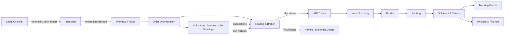
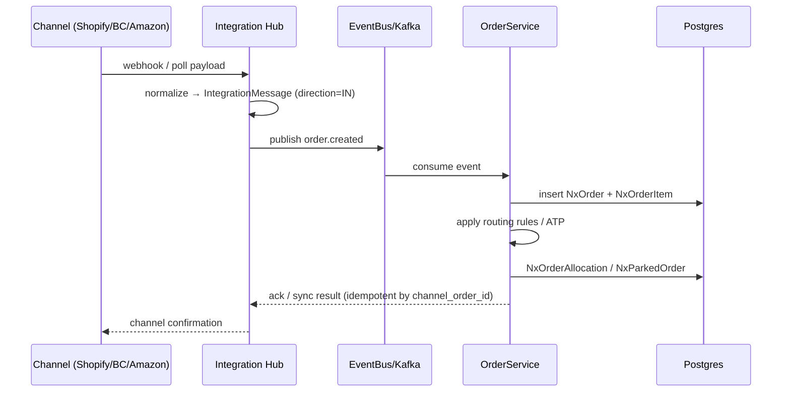
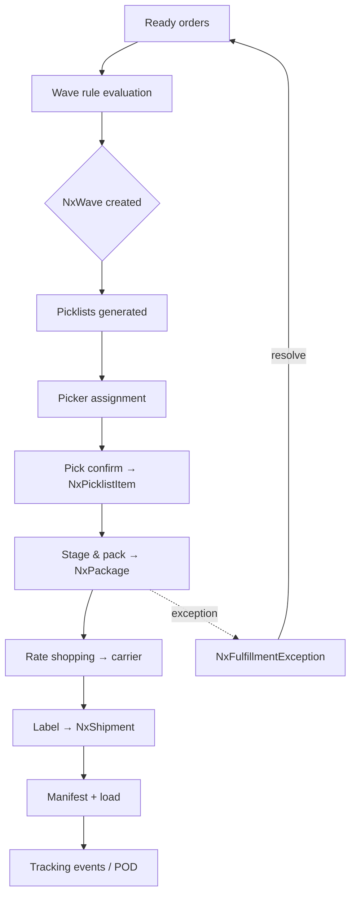
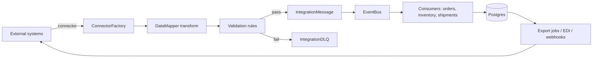
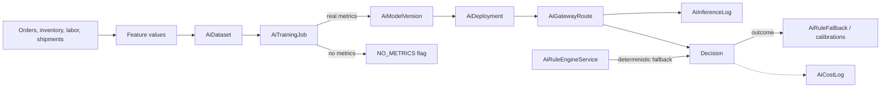
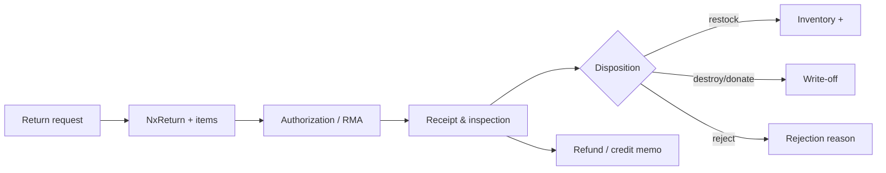
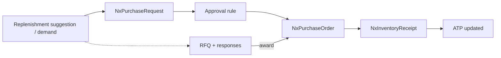
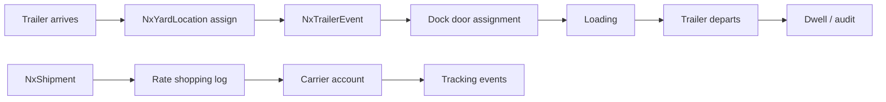

# NEXUS — Deployment Guide, System Design & Flow Diagrams

> **One document, three parts.** This guide consolidates the Nexus OMS & Supply Chain Platform's canonical reference material into a single file:
>
> - **Part I — System Design:** platform overview, service architecture, data model, integrations, AI/ML services, event streaming, security model, and frontend architecture (from `docs/ARCHITECTURE.md` and `docs/02-TECHNICAL-ARCHITECTURE.md`).
> - **Part II — Flow Diagrams:** end-to-end data movement in Mermaid notation — big picture, order intake, fulfillment, integration hub, AI platform, returns, procurement, and yard & shipping (from `docs/05-DATA-FLOW.md`, diagrams preserved verbatim).
> - **Part III — Deployment Guide:** every way to deploy Nexus — from a single laptop to production cloud clusters (from `docs/DEPLOYMENT.md`).

---

# Part I — System Design

## 1. Platform Overview

Nexus is a **full-stack Order Management System (OMS)** and supply chain platform. It covers the entire order lifecycle:

```
Order Creation → Order Approval → Allocation → Picking → Packing →
Shipping → Delivery → Returns → Refunds → Analytics
```

Plus supporting functions:
- **Inventory management** (multi-warehouse, zones, bins, cycle counts)
- **Procurement** (suppliers, purchase orders, ASNs, receiving)
- **Carrier management** (rate cards, rate shopping, labels, manifests)
- **Integrations** (Shopify, BigCommerce, Amazon, Walmart, eBay, EDI)
- **AI / ML** (order routing, demand forecasting, inventory optimization, box optimization, pick-pack-ship)
- **Analytics & reporting** (dashboards, billing, invoicing)
- **B2B / client portal** (B2B ordering, client self-service)

> 🧒 **Kid translation:** Frontend = the screens. Backend = the brain. Database = the memory. Kafka = the walkie-talkie. Redis = the speed rack. AI = the smart helpers. RBAC = the security guard.

### 1.1 System overview diagram

```
┌─────────────────────────────┐        ┌──────────────────────────────┐
│         FRONTEND            │        │       EXTERNAL WORLD         │
│  React 18 + Vite (SPA)     │        │  Shopify · BigCommerce · Amazon│
│  HashRouter · React Query   │        │  eBay · Walmart · Magento     │
│  WebSockets (STOMP/SockJS)  │        │  Stripe · FedEx · QuickBooks  │
│  Tailwind + Radix + Recharts│        │  Salesforce · SAP · Twilio    │
└─────────────┬───────────────┘        │  Okta · OpenAI · Generic HTTP │
              │  REST (axios, JWT)     └──────────────┬───────────────┘
              │  WS (stomp)                           │ connectors
┌─────────────▼───────────────┐        ┌──────────────▼───────────────┐
│         BACKEND             │        │        INTEGRATION HUB        │
│  Spring Boot 3 · Java 17    │◄──────►│  ConnectorFactory · EventBus  │
│  Spring Web · Security · JPA│        │  CredentialVault · DataMapper │
│  Validation · Cache · AOP   │        │  REST / SOAP / GraphQL / EDI  │
│  WebSocket (STOMP)          │        │  Webhooks · Batch · iPaaS-lite│
│  springdoc OpenAPI          │        └───────────────────────────────┘
└───────┬──────────┬──────────┘
        │ JPA       │ async
┌───────▼───┐  ┌────▼──────┐   ┌─────────┐   ┌─────────┐   ┌──────────┐
│ Postgres  │  │  Kafka    │   │  Redis  │   │  ai-ops │   │  ai-intel│
│ (Flyway)  │  │ (events)  │   │ (cache) │   │ (ops AI)│   │ (intel)  │
└───────────┘  └───────────┘   └─────────┘   └─────────┘   └──────────┘
                        ┌──────────────────────────────────────┐
                        │  Observability                       │
                        │  Actuator · Micrometer · Prometheus  │
                        │  Grafana · Logstash JSON · Brave     │
                        └──────────────────────────────────────┘
```

---

## 2. Service Architecture

### 2.1 Backend (Spring Boot 3, Java 17)

The core OMS API. Serves `/api/v1/**`.

**Modules (controllers):**

| Module | Endpoints |
|--------|-----------|
| Auth & RBAC | `/auth`, `/rbac`, `/users` |
| Orders | `/orders`, `/order-approvals`, `/parked-orders`, `/order-routing` |
| Inventory | `/inventory`, `/inventory-receipts`, `/cycle-counts`, `/replenishment` |
| Fulfillment | `/picking`, `/packing`, `/shipments`, `/manifests`, `/labels` |
| Returns | `/returns`, `/return-finance` |
| Carriers | `/carriers`, `/rate-cards`, `/rate-shopping` |
| Integrations | `/integrations`, `/connectors`, `/shopify`, `/bigcommerce` |
| AI | `/ai` (routing, forecasting, packing) |
| Analytics | `/analytics`, `/dashboard`, `/reports` |
| Finance | `/billing`, `/invoicing`, `/freight-audit` |
| Procurement | `/procurement`, `/asn`, `/suppliers` |
| Automation | `/automation`, `/edi-automation`, `/email-order-parsing` |
| B2B | `/client-portal`, `/b2b` |
| BOPIS | `/bopis`, `/endless-aisle` |
| Labor | `/labor`, `/picker` |
| Documents | `/documents` |
| Notifications | `/notifications` |
| Health | `/actuator/health` |

### 2.2 Frontend (React + Vite + TypeScript)

Single-page application served by nginx. Proxies `/api/` to the backend.

**Pages (60+):**
- Dashboard, Orders, Find Order, Create Order, Order Detail
- Inventory, Inventory Enhanced, Inventory Receiving, Cycle Count
- Fulfillment, Picking, Packing, Shipments, Manifests, Label Printing
- Returns, Return Finance
- Carriers, Rate Cards, Rate Shopping, Freight Audit
- Integrations (Hub, Marketplace, Stores), Shopify, BigCommerce, Amazon, eBay
- AI (Routing, Forecasting, Packing, Experiments, Briefing, Audit Trail)
- Analytics, Reports, Billing, Invoicing
- B2B Portal, Client Portal, BOPIS, Endless Aisle
- Automation, EDI, Email Order Parsing
- Labor Management, Notifications, Documents
- Settings, RBAC, Audit, Import/Export

### 2.3 AI Ops (Python, FastAPI, :5000)

Operational ML models:

| Model | Purpose |
|-------|---------|
| `model1_order_routing` | Route orders to optimal warehouse/zone |
| `model2_shipping_aggregator` | Aggregate shipments for cost savings |
| `model3_box_optimizer` | Optimize box selection for shipments |
| `model4_pick_pack_ship` | Optimize pick-pack-ship workflow |

Endpoints: `/api/health`, `/api/warmup`, `/api/predict/{route,carrier,box,pick-pack}`

### 2.4 AI Intel (Python, FastAPI, :5001)

Intelligence ML models:

| Model | Purpose |
|-------|---------|
| `model5_demand_forecasting` | Forecast demand per SKU/warehouse |
| `model6_inventory_optimization` | Optimize inventory levels |

Endpoints: `/api/health-extended`, `/api/warmup`, `/api/predict/{demand,inventory}`

### 2.5 Data stores

| Store | Purpose |
|-------|---------|
| **PostgreSQL** (pgvector) | Primary DB — all business data |
| **Redis** | Cache, sessions, rate limiting |
| **Kafka** | Event streaming — order lifecycle events |

### 2.6 Monitoring

| Service | Purpose |
|---------|---------|
| **Prometheus** | Metrics collection |
| **Grafana** | Dashboards + alerting |

---

## 3. Technology Stack

### 3.1 Backend (`nexus-oms-backend`)

| Concern | Technology | Plain-English job |
|---|---|---|
| Runtime | Java 17, Spring Boot 3 | The engine that runs the kitchen |
| Web | spring-boot-starter-web, spring-boot-starter-websocket | The doorbell + the intercom (REST + live chat) |
| Data | spring-boot-starter-data-jpa, PostgreSQL, Flyway | The fridge + recipe book that records every schema change |
| Security | spring-boot-starter-security, jjwt | The guard + ID cards (JWT) |
| Messaging | spring-kafka | The walkie-talkie between teams |
| Caching | spring-boot-starter-data-redis + cache | The speed rack for things fetched often |
| Cross-cutting | AOP, Validation, Resilience4j | The toolbox: seatbelts, rules, checks |
| AI/Docs | springdoc-openapi, jackson | The map book (API docs) + the translator (JSON) |
| Files/Reports | Apache POI, PDFBox, SAAJ | The printer (Excel, PDF, SOAP) |
| Observability | actuator, micrometer, logstash, brave | The cameras and CCTV |
| Boilerplate | Lombok | The robot that writes boring repetitive code for us |

### 3.2 Frontend (`nexus-oms-frontend`)

| Concern | Technology | Plain-English job |
|---|---|---|
| Framework | React 18 + TypeScript, Vite | The screens + paint, Vite = fast paint brush |
| Routing | react-router-dom v6 (hash) | The signposts between pages |
| Data | axios, @tanstack/react-query | The courier + smart inbox (caches answers) |
| Realtime | @stomp/stompjs + sockjs | Live "ticket arrived" updates |
| UI | Tailwind, Radix, cva, clsx, lucide | The furniture and decorations |
| Charts | recharts | The graphs |
| Sanitization | dompurify | The filter that blocks dangerous messages |
| Tests | vitest | The practice quizzes |

### 3.3 Infrastructure (docker-compose)

| Service | Plain-English job |
|---|---|
| `postgres` | The big permanent fridge |
| `redis` | The fast counter tray |
| `kafka` | The announcement speaker system |
| `backend` | The main kitchen |
| `frontend` | The screens at the counter |
| `ai-ops` | Robot that optimizes operations |
| `ai-intel` | Robot that writes boss briefings |
| `prometheus`/`grafana` | Cameras + control-room dashboards |

---

## 4. Backend Layering

```
┌─────────────────────────────────────────────────────────────┐
│ CONTROLLER LAYER   — 81 controllers, REST + WebSocket        │
│   /api/** · /ws/** · openapi at /v3/api-docs, /swagger-ui    │
├─────────────────────────────────────────────────────────────┤
│ APPLICATION LAYER — 124 services                            │
│   Order orchestration · Inventory · Fulfillment · Shipping   │
│   Returns · Procurement · Warehouse/Yard · Finance ·       │
│   AI platform · Integrations · Import/Export · Auth/RBAC     │
├─────────────────────────────────────────────────────────────┤
│ DOMAIN LAYER      — 167 JPA entities (tenant-scoped)         │
│   @ManyToOne / @OneToMany / @OneToOne / @ElementCollection   │
│   jsonb columns for flexible payloads                        │
├─────────────────────────────────────────────────────────────┤
│ INFRASTRUCTURE    — Postgres · Redis · Kafka · Flyway        │
│   Resilience4j · Cache · AOP aspects · EventBus · WebSocket   │
└─────────────────────────────────────────────────────────────┘
```

> 🍕 **Real life analogy — ordering a pizza through the layers:**
> 1. **Controller** = the waiter who takes your order at the counter ("I'll have a pepperoni").
> 2. **Service** = the head chef who decides *how* to make it ("grab dough, add sauce, add cheese, bake 8 min").
> 3. **Domain (entities)** = the actual ingredients — dough, sauce, cheese, pizza box — each with a name tag.
> 4. **Infrastructure** = the fridge (Postgres), the speed rack (Redis), and the bell to call the delivery team (Kafka).

### 4.1 Cross-cutting services

| Service | Responsibility | Plain-English |
|---|---|---|
| `PermissionService` | 74 path→resource mappings; role-permission lookup, 60s cache, allow-by-default | The list that says *which key opens which door* |
| `PermissionAuthorizationFilter` | Resolves path→resource→permission before controllers | The guard checking keys before you enter |
| `AuthService` | Login, JWT issuance, `ALLOWED_ROLES` (14 roles) | The ID-card office |
| `ImportTokenService` | Signed, expiring tokens for bulk import | The signed permission slip for big deliveries |
| `GenericImportService`/`ImportExportEngine` | CSV/Excel/JSON import + export | The bulk-copy machine |
| `EventBus` | In-process + Kafka-backed domain events | The announcement system |
| `CredentialVault` | Encrypted storage of external-connector credentials | The locked safe for passwords to other systems |

---

## 5. Data Model

Core entities (PostgreSQL):

```
┌────────────┐     ┌────────────┐     ┌────────────┐
│  CUSTOMER  │────▶│   ORDER    │────▶│  ORDER ITEM│
└────────────┘     └────────────┘     └────────────┘
                          │
              ┌───────────┼───────────┐
              ▼           ▼           ▼
        ┌──────────┐ ┌──────────┐ ┌──────────┐
        │ SHIPMENT │ │  RETURN  │ │ PAYMENT  │
        └──────────┘ └──────────┘ └──────────┘

┌────────────┐     ┌────────────┐     ┌────────────┐
│  PRODUCT   │────▶│  INVENTORY │────▶│ WAREHOUSE  │
└────────────┘     └────────────┘     └────────────┘
                          │
                          ▼
                    ┌────────────┐
                    │  ZONE/BIN  │
                    └────────────┘

┌────────────┐     ┌────────────┐     ┌────────────┐
│  SUPPLIER  │────▶│  PURCHASE  │────▶│    ASN     │
└────────────┘     │   ORDER    │     └────────────┘
                    └────────────┘
```

---

## 6. Integrations

### 6.1 Sales channels

| Channel | Direction | Data |
|---------|-----------|------|
| **Shopify** | Bidirectional | Orders in, fulfillment out, product/inventory sync |
| **BigCommerce** | Bidirectional | Orders in, fulfillment out, product/inventory sync |
| **Amazon** | Bidirectional | Orders in, fulfillment out, inventory sync |
| **Walmart** | Bidirectional | Orders in, fulfillment out |
| **eBay** | Bidirectional | Orders in, fulfillment out |

### 6.2 Carriers

| Carrier | Capability |
|---------|------------|
| **FedEx** | Rate shopping, labels, tracking |
| **UPS** | Rate shopping, labels, tracking |
| **USPS** | Rate shopping, labels, tracking |
| **DHL** | Rate shopping, labels, tracking |

### 6.3 EDI

- X12 EDI import/export (850 PO, 856 ASN, 940/945 warehouse, 810 invoice)
- EDI automation workflows

### 6.4 Email order parsing

- Parse orders from email (attachments, text)

### 6.5 Generic import engine

- CSV, JSON, XML, EDI, XLSX import for all entity types

### 6.6 Integration Hub (iPaaS-lite) 🔌

Path: `integration/`

```
integration/
├── core/
│   ├── ConnectorFactory.java        # registry + instantiation
│   ├── ConnectorFactoryConfiguration.java
│   ├── AbstractConnector.java       # base lifecycle
│   ├── BaseApiConnector.java
│   ├── GenericHttpConnector.java
│   ├── DataMapper.java              # external ↔ internal DTO mapping
│   ├── CredentialVault.java
│   ├── EventBus.java
│   ├── ConnectorHealth.java
│   └── IntegrationHubController.java
├── connector/
│   ├── ecommerce/  Shopify · BigCommerce · Magento · Amazon
│   ├── accounting/ QuickBooks
│   ├── shipping/   FedEx
│   ├── payment/    Stripe
│   ├── crm/        Salesforce
│   ├── erp/        Sap
│   ├── identity/   Okta
│   ├── communication/ Twilio
│   └── ai/         OpenAi
├── protocol/
│   ├── RestProtocolAdapter · SoapProtocolAdapter
│   ├── GraphqlProtocolAdapter · EdiProtocolAdapter
├── webhook/        WebhookIntegrationController
├── batch/          BatchJobService
└── dto/            ConnectorConfig · SyncResult · IntegrationEvent
```

> 🧒 **Kid translation:** The Integration Hub is like a **universal plug adapter**. Each store (Shopify, Amazon…) speaks its own "language" (REST, SOAP, EDI…). Nexus has one plug per language and one plug per store — so any store can connect without us rebuilding the kitchen.

**Design principles**
- One `Connector` interface; adapters translate protocol differences.
- Credentials never leave `CredentialVault`; secrets encrypted at rest.
- `EventBus` decouples ingestion (webhook/poll/batch) from processing (Kafka).
- Every connector exposes `ConnectorHealth` for the hub dashboard (like a doctor's check-up per plug).

---

## 7. AI / ML Services

### 7.1 AI Ops (operational)

| Model | Input | Output |
|-------|-------|--------|
| Order routing | Order, warehouse, capacity | Optimal warehouse/zone |
| Shipping aggregator | Shipments, carriers | Aggregated shipment plan |
| Box optimizer | Items, dimensions | Optimal box |
| Pick-pack-ship | Orders, bins | Optimized workflow |

### 7.2 AI Intel (intelligence)

| Model | Input | Output |
|-------|-------|--------|
| Demand forecasting | Historical sales, seasonality | Forecast per SKU/warehouse |
| Inventory optimization | Demand, lead time, cost | Optimal stock levels |

### 7.3 AI enablement

- `NEXUS_AI_ENABLED=true` enables AI features.
- `OPENAI_API_KEY` + `OPENAI_MODEL` for LLM features (briefings, audit trail).
- Models register via `register_model.py`.

### 7.4 AI Platform Architecture 🤖

```
                    ┌──────────────────────────────────────────┐
                    │              AI PLATFORM                 │
   Order/inventory  │  AiService (orchestrator)                │
   signals ────────►│   ├─ ForecastingEngine                   │
                    │   ├─ DemandForecastService               │
                    │   ├─ BriefingEngine / AiBriefingService  │
                    │   ├─ RuleEngine: AiRuleEngineService     │
                    │   │    └─ RuleConditionEvaluator         │
                    │   ├─ Training: AiTrainingPipelineService │
                    │   │    └─ AiTrainingJob (metricsSource)  │
                    │   ├─ Drift: DriftDetectionService        │
                    │   ├─ Models: ModelRegistryService        │
                    │   ├─ Experiments: ExperimentService      │
                    │   └─ Health: AiHealthCheck               │
                    │   External: OpenAiConnector (optional)   │
                    └──────────────────────────────────────────┘
```

> 🎓 **Real life example — teaching a robot to guess sales:**
> 1. **Collect** (features/dataset): "Last 12 months, sold 100 hoodies in Jan, 40 in Feb, 130 in Dec…"
> 2. **Train** (`AiTrainingJob`): the robot studies the pattern (winter = more hoodies).
> 3. **Evaluate**: we measure how close the robot's guesses are. **If we have no real test data, we say `NO_METRICS` — we never invent the score.** ✅ (This is the Phase 2.5 honesty promise.)
> 4. **Register/Deploy**: the approved robot goes to work.
> 5. **Monitor**: if the real world stops matching ("everyone now buys crop tops"), drift detection switches to **safe rules** until retrained.

**Honesty model (Phase 2.5)**
- **`AiTrainingJob.metricsSource`** (`V52`): `REAL` / `NO_METRICS` — no fabricated training metrics.
- **Deterministic fallbacks**: `AiRuleEngineService` computes formula values and thresholds from real order input + config with documented defaults (no `Random`).
- **Automation** returns real elapsed durations; simulated paths carry `"simulated":true`.
- **Model versioning**: a new model version is created only when the training job produces real metrics.

**Model lifecycle (target)**
```
collect → prepare → train (job) → evaluate (real metrics) → register (model registry)
  → deploy champion → serve online → monitor drift → retrain / fallback to rules
```

---

## 8. Event Streaming (Kafka)

Kafka streams order lifecycle events:

```
Order Created → Order Approved → Order Allocated → Order Picked →
Order Packed → Order Shipped → Order Delivered → Order Returned
```

Each event is published to a topic; consumers react (notifications, analytics, AI triggers, integrations).

**Topics (typical):**
- `order.created`
- `order.approved`
- `order.allocated`
- `order.picked`
- `order.packed`
- `order.shipped`
- `order.delivered`
- `order.returned`
- `inventory.updated`
- `shipment.created`

### 8.1 Data & messaging stores

| Store | Use | Plain-English |
|---|---|---|
| PostgreSQL | System of record; Flyway `V1…V67`; JPA | The permanent fridge |
| Redis | Cache (RBAC 60s, hot lookups) | The speed rack |
| Kafka | Domain events, integration ingestion, async automation | The walkie-talkie network |
| In-memory/WS | STOMP push of live updates | Live "order just arrived" screen refreshes |

### 8.2 Concurrency & idempotency

- Optimistic locking on mutable aggregates (orders, training jobs).
- Import token + idempotency keys deduplicate bulk loads.
- Retry with backoff for Kafka consumers and connector calls (circuit breakers).

> 🧒 **Kid translation of idempotency:** If the delivery person rings the bell twice, the kitchen should not cook the pizza twice. Idempotency = "same message twice = only one pizza." 🍕

---

## 9. Security Model

### 9.1 Authentication

- JWT-based auth (`/auth/login`, `/auth/register`).
- `JWT_SECRET` from `.env` (>= 32 chars).
- Token expiry: `NEXUS_JWT_EXPIRATION_MS` (default 15 min).

### 9.2 Authorization (RBAC)

Roles: **Admin, Ops Manager, Warehouse Staff, Finance, Viewer**.

Permissions enforced via `PermissionAuthorizationFilter` + `SecurityConfig`.

### 9.3 Endpoint protection

- `/actuator/health` — public (for healthchecks).
- `/actuator/**` — ADMIN only (metrics, env, etc.).
- `/api/v1/**` — authenticated (JWT).
- Admin endpoints — ADMIN role.

### 9.4 SSO / OAuth (optional)

- Google, Microsoft, Okta OAuth configured via `.env` (`GOOGLE_CLIENT_ID`, `MICROSOFT_CLIENT_ID`, `OKTA_CLIENT_ID`, etc.).

### 9.5 Security architecture

```
 Request → PermissionAuthorizationFilter (path→resource→permission)
         → JWT auth (jjwt, stateless)
         → Controller (tenant scoping enforced in services)
                    │
  Frontend: ProtectedRoute (auth) → PermissionGate (resource+action) → page
```

> 🧒 **Kid translation:** It's like a school with a **security guard**.
> 1. You show your ID card (JWT) — *proves who you are*.
> 2. The guard checks his big list — *which rooms may you enter?* (role → resource → action)
> 3. You enter only allowed rooms (data is also filtered to *your* school only — tenant scoping).

- **RBAC**: 14 roles, role↔permission rows in `nx_role_permissions`, tenant-scoped.
- **Authorization model**: `PermissionService.PATH_TO_RESOURCE` (74 mappings), first-prefix-match, `*:*` for ADMIN, **allow-by-default** (documented trade-off — see `06-BUSINESS-FLOW-RBAC.md`).
- **Multi-tenancy**: every entity carries tenant scope.
- **Import security**: signed import tokens with expiry; idempotency keys.
- **External credentials**: encrypted `CredentialVault`; Okta SSO; MFA-ready.

---

## 10. Frontend Architecture

### 10.1 Stack

- **React 18** + **TypeScript**
- **Vite** build tool
- **nginx** static server + reverse proxy
- **React Router** for SPA routing

### 10.2 Routing

```
/                    → Dashboard
/orders              → Orders list
/orders/:id          → Order detail
/inventory           → Inventory
/fulfillment         → Fulfillment
/shipments           → Shipments
/returns             → Returns
/carriers            → Carriers
/integrations        → Integration Hub
/ai                  → AI platform
/analytics           → Analytics
/b2b                 → B2B portal
/settings            → Settings
```

### 10.3 API access

The frontend calls the backend via `/api/v1/**`, proxied by nginx:

```nginx
location /api/ {
    proxy_pass http://backend:8080;
}
```

### 10.4 Frontend architecture notes

- **Entry** `src/main.tsx` → `App.tsx` defines HashRouter + lazy `Route` elements wrapped in `ProtectedRoute` + `AppLayout`.
- **Guards**: `ProtectedRoute` (authenticated), `PermissionGate` (resource+action; **caveat G2**: 6 pages pass a non-functional `permission` prop), legacy unused `RoleProtectedRoute`.
- **API layer**: typed clients per domain in `src/api/`; `src/types/index.ts` mirrors backend DTOs.
- **State**: React Query server-state caching; STOMP subscription for realtime.
- **Charts/UX**: recharts; Radix + Tailwind; LaunchPad groups navigation by role.

---

# Part II — Flow Diagrams

> End-to-end data movement: ingestion, orchestration, fulfillment, integration and AI. Mermaid notation. Diagrams preserved verbatim from `docs/05-DATA-FLOW.md`.

## 0. Start Here — What is a "data flow"? 🚿

A data flow is the **path a piece of information travels**, like water through pipes. Real-life example:

> 🛍️ **Mia buys a hoodie at 9:04 pm.** Follow the hoodie's journey:
> 1. Shopify sends "order #1001" → Nexus (ingestion)
> 2. Nexus checks stock (ATP) → reserves 1 hoodie
> 3. Nexus groups it into tomorrow's wave → picklist
> 4. A picker picks it → packed → shipped → tracked
> 5. A receipt (invoice) is created → analytics updated

Each arrow below is one of those steps. **The diagrams are the plumbing map.**

---

## 1. The Big Picture (order → dispatch → analytics)



> 🧒 **Kid translation of the big picture:** A ball (the order) rolls down a slide: **in the front door (channel) → into the sorter (orchestration) → through the stock checker (ATP) → into the basket (wave) → picked → packed → shipped → billed → counted.** If the sorter can't handle it, the ball goes into the "waiting bin" (parked) instead of getting lost.

---

## 2. Order Intake Flow



**Idempotency:** orders keyed by `channel_order_id` + store; duplicate webhooks are skipped.
> 🧒 **Kid translation of idempotency:** If the doorbell rings twice, you don't cook two pizzas. Same order message twice = still one order.

---

## 3. Fulfillment Flow (wave → ship)



> 🏭 **Real life example — the warehouse morning:**
> - **6:30 am** — Nexus groups 200 orders by aisle (a wave).
> - **7:00** — Pickers get picklists; each walks one aisle once.
> - **9:30** — Packers box everything; Nexus picks the cheapest carrier per box.
> - **11:00** — A truck leaves with 180 packages; customers get tracking numbers.
> - Meanwhile one box was short — the exception path flagged it at 9:35, a manager fixed it by 10:00.

---

## 4. Integration Hub Data Flow (iPaaS)



**Supporting stores:** `NxIntegrationFlow` + steps, `NxIntegrationSyncConfig`, `NxIntegrationAuditLog`, `IntegrationCDCEvent`.

> 📬 **Real life analogy — the mail room:**
> Every store's messages are letters. The mail room (hub) opens them (connector), translates them (DataMapper), checks the address (validation). Good letters go to the kitchen (EventBus). Bad letters go to the "can't read" bin (DLQ) — **never thrown away**, so ops can fix and resend.

---

## 5. AI Platform Data Flow



**Honesty guarantees (Phase 2.5):**
- Training metrics are stored only when real (`metricsSource=REAL`), else `NO_METRICS` + null metrics.
- Rule evaluation is deterministic from config + order input.
- Automation results carry real `elapsed_ms` and explicit `simulated` flags.

> 🎓 **Real life example — the robot gets a grade:**
> The robot studies 12 months of sales (`AiDataset`). After training (`AiTrainingJob`), we grade it on data we held back. If we have held-back real data → report card shows REAL metrics and a model version is born. If we have no test data → the card honestly says `NO_METRICS`. We never invent a grade.

---

## 6. Returns Data Flow



> 🎁 **Real life example — the stained hoodie:**
> Mia returns the hoodie (request) → gets RMA #88 → warehouse receives it and inspects (stain!) → disposition = **destroy** → Nexus posts a write-off and tells Finance → Finance issues a partial refund. Every step recorded.

---

## 7. Procurement Data Flow



> 🏗️ **Real life example — the hoodie shortage:**
> AI notices hoodies sell out every winter → suggestion "buy 120" → request "over $500 needs approval" → approved → PO sent to CottonCo → hoodies arrive → receiving adds them → customers can order again.

---

## 8. Yard & Shipping Data Flow



> 🚚 **Real life example — truck at the dock:**
> Truck T-7 arrives 8:00 → parked at Yard Spot 2 (event logged) → dock 3 free → assigned → loaded by 10:30 → departs 11:00 (dwell = 3h). Meanwhile the shipment got its rate-shop + label + tracking. All visible on one screen.

---

## 9. Cross-cutting concerns in every flow

| Concern | Mechanism | Plain-English |
|---|---|---|
| **Tenancy** | Every query scoped by `tenant_id` | Your data stays in your locker |
| **Authorization** | `PermissionAuthorizationFilter` (74 mappings) | The guard checks badges |
| **Audit** | `NxAuditLog`, `IntegrationAuditLog` | The logbook records who did what |
| **Idempotency** | `channel_order_id` keys, import tokens, sync state | No double-cooking pizzas |
| **Resilience** | Kafka retries + Resilience4j breakers | Seatbelts so one failure doesn't crash everything |
| **Observability** | Micrometer/Prometheus, logstash JSON | Cameras on every pipe |

---

# Part III — Deployment Guide

> This guide covers **every** way to deploy the Nexus platform — from a single laptop to production cloud clusters. It is the canonical reference for getting Nexus running anywhere.

## Table of Contents

1. [Architecture Overview](#1-architecture-overview)
2. [Prerequisites](#2-prerequisites)
3. [Local Deployment (laptop / workstation)](#3-local-deployment)
4. [Single-Server Deployment (EC2 / VPS / bare metal)](#4-single-server-deployment)
5. [Cloud Platform Deployment](#5-cloud-platform-deployment)
   - [AWS EC2](#51-aws-ec2)
   - [AWS ECS](#52-aws-ecs)
   - [Google Cloud (GCP)](#53-google-cloud-gcp)
   - [Azure](#54-azure)
   - [DigitalOcean / Linode / Hetzner](#55-digitalocean--linode--hetzner)
6. [Environment Matrix (Dev / UAT / Prod)](#6-environment-matrix)
7. [Sizing by Record Volume](#7-sizing-by-record-volume)
8. [Security Hardening](#8-security-hardening)
9. [TLS / Reverse Proxy](#9-tls--reverse-proxy)
10. [Backup & Disaster Recovery](#10-backup--disaster-recovery)
11. [Troubleshooting](#11-troubleshooting)

---

## 1. Architecture Overview

Nexus is a full-stack Order Management System (OMS) and supply chain platform. The Docker stack consists of **9 services**:

| Service      | Container        | Port  | Description                                   |
|--------------|------------------|-------|-----------------------------------------------|
| PostgreSQL   | `nexus-postgres` | 5433  | Primary database (pgvector/pg16)              |
| Redis        | `nexus-redis`    | 6379  | Cache & sessions                              |
| Kafka        | `nexus-kafka`    | 9092  | Event streaming / order lifecycle             |
| Backend      | `nexus-backend`  | 8080  | Spring Boot 3 OMS API (`/api/v1`)             |
| Frontend     | `nexus-frontend` | 80    | React + Vite SPA (nginx)                      |
| AI Ops       | `nexus-ai-ops`   | 5000  | Python ML — order routing                     |
| AI Intel     | `nexus-ai-intel` | 5001  | Python ML — demand & inventory                |
| Prometheus   | `nexus-prometheus`| 9090 | Metrics scraping                              |
| Grafana      | `nexus-grafana`  | 3001  | Dashboards & alerting                         |

```
                    ┌─────────────────────────────────────────────┐
                    │              FRONTEND (nginx :80)           │
                    │         React SPA + /api proxy              │
                    └───────────────┬─────────────────────────────┘
                                    │ /api/v1
                    ┌───────────────▼─────────────────────────────┐
                    │              BACKEND (Spring :8080)         │
                    │  Auth · Orders · Inventory · Shipments      │
                    │  Returns · Analytics · Integrations · AI    │
                    └───┬────────┬────────┬──────────┬────────────┘
                        │        │        │          │
              ┌─────────▼──┐ ┌───▼──┐ ┌───▼─────┐ ┌──▼──────────┐
              │ POSTGRES   │ │REDIS │ │ KAFKA   │ │ AI OPS      │
              │ pgvector   │ │cache │ │ events  │ │ AI INTEL    │
              │ :5433      │ │:6379 │ │ :9092   │ │ :5000/:5001 │
              └────────────┘ └──────┘ └─────────┘ └─────────────┘
                    ┌───────────────┬─────────────────────────────┐
                    │  PROMETHEUS   │        GRAFANA              │
                    │  :9090        │        :3001                │
                    └───────────────┴─────────────────────────────┘
```

**Key design points:**
- All secrets come from `.env` (gitignored) — **never** hardcoded.
- Named volumes persist data across container restarts.
- `restart: unless-stopped` on every service for auto-recovery.
- Backend waits for postgres/redis healthy before starting (`depends_on`).
- `SPRING_PROFILES_ACTIVE=prod` enables hardened production config.

---

## 2. Prerequisites

| Requirement | Version | Notes |
|-------------|---------|-------|
| Docker Engine | 24+ | `docker --version` |
| Docker Compose | v2 | `docker compose version` |
| Git | any | `git --version` |
| CPU arch | x86_64 **or** arm64 | The compose supports both (Apple Silicon + Graviton) |
| RAM | 8 GB min, 16 GB recommended | Java + 2 Python ML + Kafka |
| Disk | 30 GB+ | Images + data volumes |

**Verify Docker:**
```bash
docker --version
docker compose version
docker info | grep -i architecture   # x86_64 or aarch64
```

---

## 3. Local Deployment

### 3.1 Quick start (laptop / workstation)

```bash
# 1. Clone
git clone https://github.com/Mr-Mayank-Sharma/Nexus-docker.git
cd Nexus-docker

# 2. Create .env
cp .env.example .env

# 3. Edit .env — set REQUIRED secrets
#    DB_PASSWORD, JWT_SECRET (>=32 chars), GRAFANA_ADMIN_PASSWORD
#    Generate:  openssl rand -base64 48

# 4. Build & start
docker compose up -d --build

# 5. Verify
docker compose ps
curl http://localhost:8080/api/v1/actuator/health
```

### 3.2 Access URLs (local)

| Service | URL |
|---------|-----|
| Frontend | http://localhost |
| Backend API | http://localhost:8080/api/v1 |
| Grafana | http://localhost:3001 |
| Prometheus | http://localhost:9090 |
| PostgreSQL | localhost:5433 |
| Redis | localhost:6379 |
| Kafka | localhost:9092 |

### 3.3 Stop / tear down

```bash
docker compose down        # stop (keep data)
docker compose down -v     # stop AND delete all data volumes
```

### 3.4 One-shot setup script

```bash
# Clones, creates .env, builds, starts — all in one
bash scripts/setup.sh
```

---

## 4. Single-Server Deployment

This is the **recommended starting point** for production — one server runs the whole stack. Works on EC2, any VPS, or bare metal.

### 4.1 Provision the server

- **OS:** Ubuntu 22.04 LTS (or Amazon Linux 2023)
- **Arch:** x86_64 or ARM64 (Graviton)
- **Size:** 4 vCPU / 16 GB RAM minimum (see [Sizing](#7-sizing-by-record-volume))
- **Disk:** 30 GB+ SSD

### 4.2 Install Docker

```bash
# Ubuntu
sudo apt update
sudo apt install -y docker.io docker-compose-v2 git
sudo systemctl enable --now docker
sudo usermod -aG docker $USER
# log out and back in
```

### 4.3 Deploy

```bash
git clone https://github.com/Mr-Mayank-Sharma/Nexus-docker.git
cd Nexus-docker
cp .env.example .env
nano .env   # set DB_PASSWORD, JWT_SECRET, GRAFANA_ADMIN_PASSWORD, CORS_ORIGINS

docker compose up -d --build
```

### 4.4 Firewall / security group

Open inbound ports:
- `80` (HTTP — frontend) — **required**
- `22` (SSH) — required
- `8080`, `3001`, `9090` — **optional** (recommend keeping behind reverse proxy)

---

## 5. Cloud Platform Deployment

### 5.1 AWS EC2

**Step 1 — Create instance**
- AMI: Ubuntu 22.04 LTS
- Instance type: `t3.xlarge` (4 vCPU / 16 GB) minimum
- Storage: 30 GB+ SSD
- Security group: open `80`, `22` (and `8080`/`3001` if exposing directly)

**Step 2 — SSH & install**
```bash
ssh -i your-key.pem ubuntu@YOUR_EC2_IP
sudo apt update && sudo apt install -y docker.io docker-compose-v2 git
sudo systemctl enable --now docker
```

**Step 3 — Deploy**
```bash
git clone https://github.com/Mr-Mayank-Sharma/Nexus-docker.git
cd Nexus-docker
cp .env.example .env
nano .env
# IMPORTANT: set CORS_ORIGINS=http://YOUR_EC2_IP,http://YOUR_DOMAIN
docker compose up -d --build
```

**Step 4 — Access**
- Frontend: `http://YOUR_EC2_IP`
- Grafana: `http://YOUR_EC2_IP:3001`

> ⚠️ For production, put TLS in front (see [Section 9](#9-tls--reverse-proxy)).

### 5.2 AWS ECS

For horizontal scaling and managed orchestration.

**Step 1 — Push images to ECR**
```bash
aws ecr-public get-login-password | docker login --username AWS --password-stdin \
  YOUR_ACCOUNT.dkr.ecr.us-east-1.amazonaws.com

docker tag nexus-backend YOUR_ACCOUNT.dkr.ecr.us-east-1.amazonaws.com/nexus-backend:latest
docker push YOUR_ACCOUNT.dkr.ecr.us-east-1.amazonaws.com/nexus-backend:latest
# repeat for frontend, ai-ops, ai-intel
```

**Step 2 — Deploy with ECS Compose**
```bash
ecs-cli compose --project-name nexus up
```

**Step 3 — Or use ECS with individual services**
- Create a task definition per service
- Use the ECR images
- Wire up service discovery + load balancer

> ECS is more complex. **Start with EC2 + Compose** unless you need scaling.

### 5.3 Google Cloud (GCP)

**Option A — Compute Engine (single VM)** — same as EC2:
```bash
gcloud compute ssh --zone us-central1-a nexus-vm
sudo apt update && sudo apt install -y docker.io docker-compose-v2 git
git clone https://github.com/Mr-Mayank-Sharma/Nexus-docker.git
cd Nexus-docker && cp .env.example .env && nano .env
docker compose up -d --build
```

**Option B — Cloud Run / GKE** — push images to GCR:
```bash
gcloud auth configure-docker
docker tag nexus-backend gcr.io/YOUR_PROJECT/nexus-backend:latest
docker push gcr.io/YOUR_PROJECT/nexus-backend:latest
# deploy via Cloud Run service or GKE pod
```

### 5.4 Azure

**Option A — Azure VM** — same as EC2:
```bash
az vm ssh --resource-group nexus --name nexus-vm
sudo apt update && sudo apt install -y docker.io docker-compose-v2 git
git clone https://github.com/Mr-Mayank-Sharma/Nexus-docker.git
cd Nexus-docker && cp .env.example .env && nano .env
docker compose up -d --build
```

**Option B — Azure Container Apps / AKS** — push to ACR:
```bash
az acr login --name nexus
docker tag nexus-backend nexus.azurecr.io/nexus-backend:latest
docker push nexus.azurecr.io/nexus-backend:latest
```

### 5.5 DigitalOcean / Linode / Hetzner

All are single-VM providers — identical to the EC2 flow:

```bash
# SSH in, then:
sudo apt update && sudo apt install -y docker.io docker-compose-v2 git
git clone https://github.com/Mr-Mayank-Sharma/Nexus-docker.git
cd Nexus-docker && cp .env.example .env && nano .env
docker compose up -d --build
```

---

## 6. Environment Matrix

Run **separate instances** for Dev, UAT, and Prod. Each gets its own `.env`, its own data volumes, and (ideally) its own host.

| Environment | Purpose | Host | Data | CORS | Profile |
|-------------|---------|------|------|------|---------|
| **Dev** | Active development | Local / shared VM | Throwaway (reset often) | `http://localhost:5173` | `dev` |
| **UAT** | User acceptance testing | Staging server | Persistent (test data) | `http://uat.example.com` | `prod` |
| **Prod** | Live production | Dedicated server | Persistent (real data) | `https://app.example.com` | `prod` |

### 6.1 Dev instance

```bash
# Local dev — use the dev profile, allow localhost CORS
cp .env.example .env
# .env:
#   SPRING_PROFILES_ACTIVE=dev
#   CORS_ORIGINS=http://localhost:5173,http://localhost:3000
#   NEXUS_AI_ENABLED=false
docker compose up -d --build
```

### 6.2 UAT instance

```bash
# Staging — prod profile but test data
cp .env.example .env
# .env:
#   SPRING_PROFILES_ACTIVE=prod
#   CORS_ORIGINS=https://uat.example.com
#   NEXUS_AI_ENABLED=true
docker compose up -d --build
```

### 6.3 Prod instance

```bash
# Production — hardened, real data
cp .env.example .env
# .env:
#   SPRING_PROFILES_ACTIVE=prod
#   CORS_ORIGINS=https://app.example.com
#   NEXUS_AI_ENABLED=true
#   NEXUS_LOG_LEVEL=WARN
docker compose up -d --build
```

---

## 7. Sizing by Record Volume

Nexus scales from a small demo to high-volume production. Use this table to pick the right server size. "Records" = orders + inventory + shipments + returns processed per day.

### 7.1 Sizing matrix

| Tier | Daily Records | vCPU | RAM | Disk | Recommended Host |
|------|---------------|------|-----|------|------------------|
| **S** (Demo/POC) | < 1,000 | 2 | 8 GB | 30 GB | Laptop / t3.medium |
| **M** (Small prod) | 1k – 10k | 4 | 16 GB | 50 GB | t3.xlarge / 4 vCPU VPS |
| **L** (Medium prod) | 10k – 100k | 8 | 32 GB | 100 GB | t3.2xlarge / 8 vCPU |
| **XL** (Large prod) | 100k – 1M | 16 | 64 GB | 200 GB | Dedicated / ECS cluster |
| **XXL** (Enterprise) | 1M+ | 32+ | 128 GB+ | 500 GB+ | Kubernetes / ECS + scaling |

### 7.2 What drives resource usage

| Component | Resource driver | Scales with |
|-----------|-----------------|-------------|
| **Backend (Java)** | CPU + RAM | Concurrent API calls, order volume |
| **PostgreSQL** | Disk + RAM | Total records, write throughput |
| **Redis** | RAM | Session count, cache size |
| **Kafka** | Disk + RAM | Event throughput (order lifecycle) |
| **AI Ops / AI Intel** | CPU + RAM | Prediction frequency, model size |
| **Prometheus / Grafana** | Disk | Metric retention |

### 7.3 Case studies

**Case A — Small merchant (500 orders/day)**
- 2 vCPU / 8 GB / 30 GB — works on a laptop or t3.medium
- Single node, all 9 services
- Kafka single broker, no replication

**Case B — Regional 3PL (5,000 orders/day)**
- 4 vCPU / 16 GB / 50 GB — t3.xlarge
- Single node, all 9 services
- Enable AI (order routing, demand forecast)
- Daily DB backup

**Case C — National retailer (50,000 orders/day)**
- 8 vCPU / 32 GB / 100 GB — t3.2xlarge
- Consider splitting: DB on one host, app+AI on another
- Kafka with replication, Redis with persistence
- Hourly DB backup + point-in-time recovery

**Case D — Enterprise / multi-tenant (500,000+ orders/day)**
- 16+ vCPU / 64 GB+ / 200 GB+ — dedicated cluster
- ECS/Kubernetes with horizontal scaling
- Separate DB cluster (RDS/Aurora), managed Kafka (MSK)
- Full HA: load balancer, multiple app replicas, DB replication

---

## 8. Security Hardening

The compose ships with production defaults, but harden further for live use:

1. **Strong secrets** — `openssl rand -base64 48` for `DB_PASSWORD`, `JWT_SECRET`, `GRAFANA_ADMIN_PASSWORD`.
2. **Never commit `.env`** — it's gitignored. Use a secrets manager in prod.
3. **TLS everywhere** — terminate at a reverse proxy (see below).
4. **Restrict CORS** — set `CORS_ORIGINS` to your exact domain(s).
5. **Don't expose admin ports** — keep 8080/3001/9090 behind the proxy.
6. **DB access** — postgres is on `5433`; don't expose it publicly.
7. **Kafka** — internal only; don't expose `9092` publicly.
8. **AI keys** — `OPENAI_API_KEY` etc. stay in `.env`, never in code.
9. **Logging** — set `NEXUS_LOG_LEVEL=WARN` in prod to reduce noise.
10. **Backups** — automate DB + volume backups (see Section 10).

---

## 9. TLS / Reverse Proxy

For production, put nginx (or Caddy) in front and terminate TLS.

### 9.1 nginx reverse proxy (with Let's Encrypt)

```nginx
# /etc/nginx/sites-available/nexus
server {
    listen 80;
    server_name app.example.com;
    return 301 https://$host$request_uri;
}

server {
    listen 443 ssl;
    server_name app.example.com;

    ssl_certificate     /etc/letsencrypt/live/app.example.com/fullchain.pem;
    ssl_certificate_key /etc/letsencrypt/live/app.example.com/privkey.pem;

    location / {
        proxy_pass http://localhost:80;          # frontend
        proxy_set_header Host $host;
        proxy_set_header X-Real-IP $remote_addr;
    }

    location /api/ {
        proxy_pass http://localhost:8080;        # backend
        proxy_set_header Host $host;
        proxy_set_header X-Real-IP $remote_addr;
    }
}
```

### 9.2 Get a cert

```bash
sudo apt install -y certbot python3-certbot-nginx
sudo certbot --nginx -d app.example.com
```

---

## 10. Backup & Disaster Recovery

### 10.1 PostgreSQL backup

```bash
# Manual
docker exec nexus-postgres pg_dump -U nexus -d nexus_oms > backup.sql

# Cron (daily at 2am)
0 2 * * * docker exec nexus-postgres pg_dump -U nexus -d nexus_oms | gzip > /backups/nexus_$(date +\%F).sql.gz
```

### 10.2 Volume backup

```bash
# Back up named volumes
docker run --rm -v nexus_postgres-data:/data -v /backups:/backup \
  alpine tar czf /backup/postgres-data.tar.gz -C /data .
```

### 10.3 Restore

```bash
# Restore DB
cat backup.sql | docker exec -i nexus-postgres psql -U nexus -d nexus_oms

# Restore volume
docker run --rm -v nexus_postgres-data:/data -v /backups:/backup \
  alpine tar xzf /backup/postgres-data.tar.gz -C /data
```

### 10.4 Disaster recovery checklist

1. Re-provision the server (same OS/arch).
2. Install Docker + Compose.
3. Clone the repo, restore `.env`.
4. `docker compose up -d --build`.
5. Restore DB + volumes.
6. Verify healthcheck.

---

## 11. Troubleshooting

### Backend won't start
```bash
docker logs nexus-backend | tail -50
```
- **`UnsatisfiedDependencyException` for `AmazonS3`** → set `NEXUS_S3_ENABLED=true` (the app requires the S3 bean).
- **`password authentication failed`** → stale postgres volume. Reset: `docker compose down -v && docker compose up -d`.

### Frontend unhealthy
```bash
docker logs nexus-frontend | tail -20
```
- The healthcheck uses `curl` (BusyBox `wget` returns exit 1). Rebuild: `docker compose build frontend`.

### CORS errors in browser
- Set `CORS_ORIGINS` in `.env` to your exact frontend origin and restart backend.

### Prometheus shows targets "down"
- Backend `/actuator/prometheus` requires ADMIN auth; kafka/redis/postgres need exporters. See `monitoring/prometheus/prometheus.yml` for how to enable.

### Reset everything
```bash
docker compose down -v && docker compose up -d --build
```

---

*Consolidated from `docs/DEPLOYMENT.md` · `docs/ARCHITECTURE.md` · `docs/05-DATA-FLOW.md` · `docs/02-TECHNICAL-ARCHITECTURE.md` for the Nexus OMS & Supply Chain Platform.*