# 11 — System Design: Structural Views, Sequences, State Machines and Topology

> **What this document is.** The diagram companion to the Nexus documentation set.
> Every diagram here is derived from the source tree — CI job IDs, servlet filter
> ordering, Kafka topic names, status literals and container ports were read out of
> the code, not recalled from memory. The exact commands to re-derive each one are
> in [Appendix Re Deriving Diagrams](#appendix-re-deriving-diagrams).
>
> **What this document is not.** It is not another prose guide. For stack and
> component descriptions see [02 Technical Architecture](./02-TECHNICAL-ARCHITECTURE.md)
> and [ARCHITECTURE](./ARCHITECTURE.md); for entity structure see
> [03 ER Diagram](./03-ER-DIAGRAM.md); for end-to-end data movement see
> [05 Data Flow](./05-DATA-FLOW.md); for current verified counts see
> [01 Current State](./01-CURRENT-STATE.md). This document deliberately restates
> **no** hard numbers, so it can never drift out of sync with the CI claim checks.

## Contents

- [Scope](#scope)
- [Structural Views](#structural-views)
  - [C4 Context](#c4-context)
  - [C4 Container](#c4-container)
  - [C4 Component Backend](#c4-component-backend)
  - [Deployment Topology](#deployment-topology)
- [Delivery Pipeline](#delivery-pipeline)
  - [CI Pipeline](#ci-pipeline)
  - [CD Pipeline](#cd-pipeline)
- [Request Paths](#request-paths)
  - [Authentication and Authorization](#authentication-and-authorization)
  - [Webhook Ingestion](#webhook-ingestion)
  - [Generic Import Engine](#generic-import-engine)
- [State Machines](#state-machines)
  - [Order Lifecycle](#order-lifecycle)
  - [Fulfillment Lifecycle](#fulfillment-lifecycle)
  - [Shipment Lifecycle](#shipment-lifecycle)
  - [Return Lifecycle](#return-lifecycle)
  - [Procurement Lifecycle](#procurement-lifecycle)
- [Event Topology](#event-topology)
- [Frontend Architecture](#frontend-architecture)
- [Security Topology](#security-topology)
- [Appendix Re Deriving Diagrams](#appendix-re-deriving-diagrams)

## Scope

| Section | Question it answers | Diagram type |
|---|---|---|
| Structural Views | What exists and how does it fit together? | C4 context, container, component, deployment |
| Delivery Pipeline | How does a change reach production? | CI/CD graph |
| Request Paths | What happens to one request? | Sequence |
| State Machines | What values may an object hold and in what order? | stateDiagram-v2 |
| Event Topology | Which events exist and where do they go? | Flow graph |
| Frontend Architecture | How is the SPA organised? | Flow graph |
| Security Topology | Where are the trust boundaries? | Flow graph |

> 🧒 **In plain words:** if the architecture docs explain *what the boxes are*,
> this document draws *the boxes, how they talk, and what state they can be in*.

## Structural Views

### C4 Context

Nexus sits between the people who buy things, the channels that sell them, and the
physical supply chain that fulfils them.

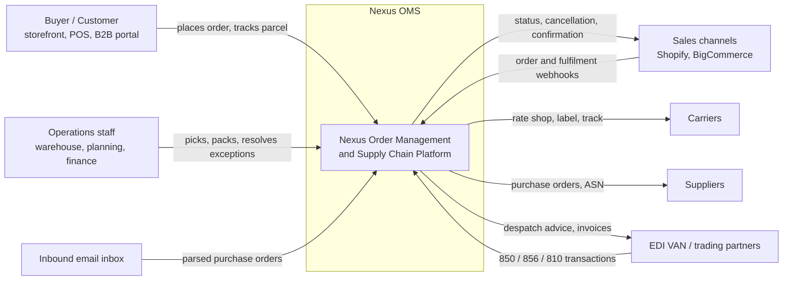

> 🧒 **In plain words:** Nexus takes orders from many doors — websites, email,
> EDI, staff — and pushes work out to warehouses, carriers and suppliers, then
> tells the original door what happened.

### C4 Container

Nine containers are defined in `docker-compose.yml`, plus the browser. Port
mappings below are the literal host-to-container bindings from that file.

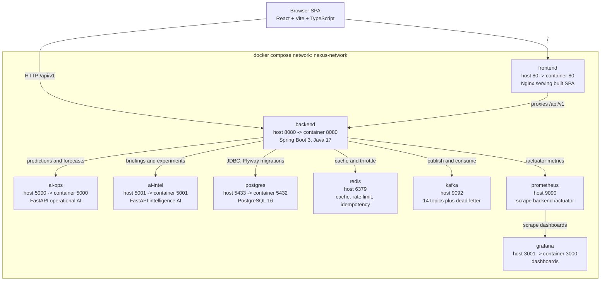

Storage volumes `postgres-data`, `redis-data`, `kafka-data`, `prometheus-data` and
`grafana-data` survive `docker compose down` and are only removed by `down -v`.

> 🧒 **In plain words:** one machine runs everything. The browser talks to Nginx
> and the API directly; the API is the only container allowed to touch the
> database.

### C4 Component Backend

The backend package layout as found under `com.nexus.oms`:

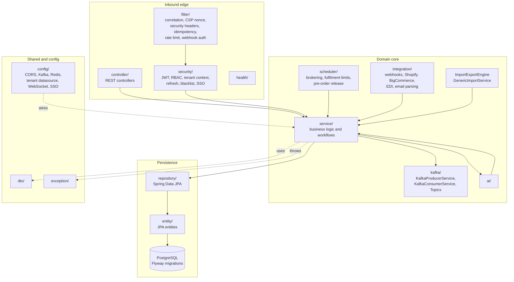

> 🧒 **In plain words:** controllers take the request, services do the thinking,
> repositories talk to the database. Filters and security sit in front of all of
> it; schedulers, integrations and Kafka producers sit behind it and call into
> the same services.

### Deployment Topology

Single-host production layout. TLS terminates at Nginx; only the edge ports are
reachable from outside the host.

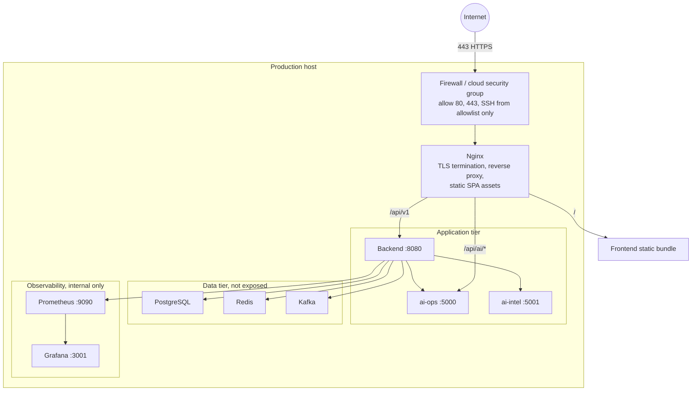

Stand-alone firewall rules are listed in
[03 Deployment Guide section 4](../DEPLOYMENT_GUIDE.md) and sizing tiers in
section 7 of the same document.

## Delivery Pipeline

### CI Pipeline

Workflow `.github/workflows/ci.yml`, triggered on pushes and pull requests to
`main` and `develop`. Job IDs are the literal YAML keys.

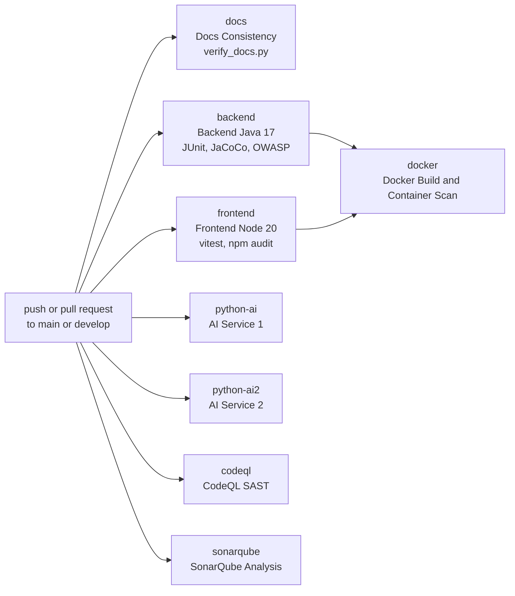

Notes worth knowing:

- `docker` declares `needs: [backend, frontend]`, so a red backend or frontend
  job blocks the image scan.
- The `docs` job runs `python3 scripts/verify_docs.py --no-surefire`, which
  recomputes every published count from the source tree. See
  [Appendix Re Deriving Diagrams](#appendix-re-deriving-diagrams).
- The `env.` context is not available when `jobs.<id>.name` is evaluated, so the
  workflow uses literal names; referencing it there is a fatal parse error.

> 🧒 **In plain words:** every push runs documentation truth-checking, the two
> real test suites, both AI services, and two security scanners in parallel. Only
> when the backend and frontend both pass does the container get built and
> scanned.

### CD Pipeline

Workflow `.github/workflows/cd.yml`, triggered by version tags `v*`, by pushes
to `main`, and by manual `workflow_dispatch`.

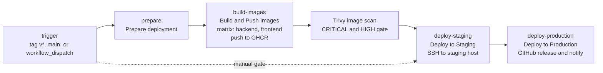

The staging and production steps are separate jobs rather than environment
gates, so a failed staging deploy stops the chain before production is reached.

## Request Paths

### Authentication and Authorization

Two layers of filters run on every request. Servlet-registered filters carry
`@Order` annotations and run first; the Spring Security chain is assembled
explicitly in `SecurityConfig`.

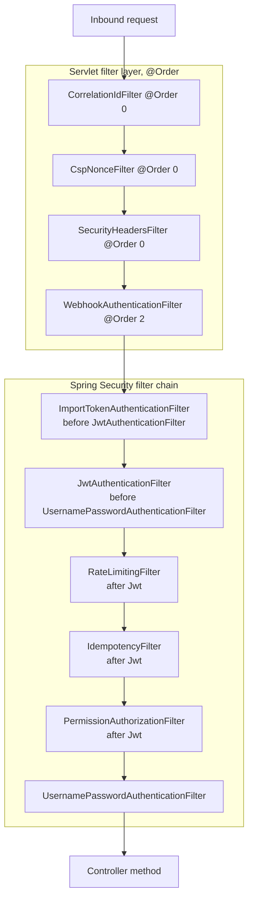

Permit-all and restricted matchers, transcribed from `SecurityConfig`:

| Matcher | Access |
|---|---|
| `/auth/**` | permit all |
| `/swagger-ui/**`, `/v3/api-docs/**` | permit all |
| `/actuator/health` | permit all |
| `/ws/**` | permit all |
| `/webhooks/**` | permit all |
| `/assets/**`, `*.html`, `*.js`, `*.css`, `/` | permit all |
| `/actuator/**` | role `ADMIN` only |
| `POST /import/**` | authenticated |
| any other request | authenticated |

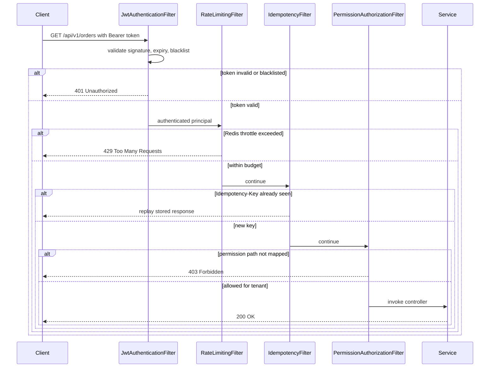

> 🧒 **In plain words:** identify the caller, check they are not being rate
> flooded, make sure the same request is not applied twice, then check their
> role is allowed to touch this specific endpoint. Only then does business code
> run.

### Webhook Ingestion

External channels push events into `/webhooks/**`, which is reachable without a
bearer token — so signature verification happens in the filter chain instead.

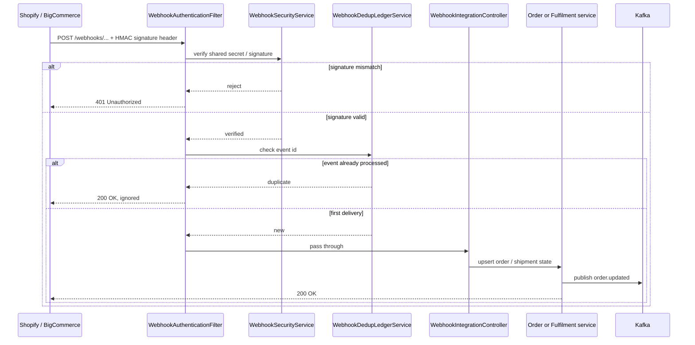

Replay protection is what the dedup ledger buys: channels retry aggressively,
and a ledger lookup is cheaper than a second write.

### Generic Import Engine

Uploads reach `POST /import/{entityType}`. Two authentication paths are
accepted — a normal JWT, or a short-lived `X-Import-Token` issued by
`ImportTokenService` for machine-to-machine uploads.

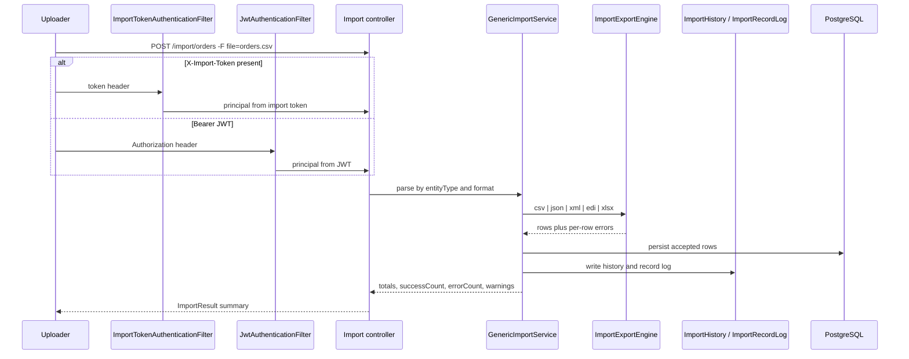

Row-level errors are reported rather than aborting the whole file, so a single
bad record does not block a bulk load.

## State Machines

> ⚠️ **Read this before trusting an edge.** Status fields in Nexus are plain
> `String` columns, not Java enums or check constraints. `NxOrder.status`
> defaults to `PENDING` via a null guard, and any service may write any literal
> it chooses. The **values** below are verified from `setStatus(...)` call
> sites; the **edges** show the observed stage owners and the conventional
> happy path. Nothing in the database will stop a transition the diagrams do
> not show.

### Order Lifecycle

Statuses written by services that operate on `NxOrder`. Plausible-looking
neighbours — `PICKED`, `PACKED`, `LABELED`, `REJECTED`, `ESCALATED`,
`PENDING_APPROVAL`, `EXPIRED` — are **not** order statuses; they belong to the
pick item, package, shipment, exception, procurement and brokering-queue
entities shown in the diagrams below.

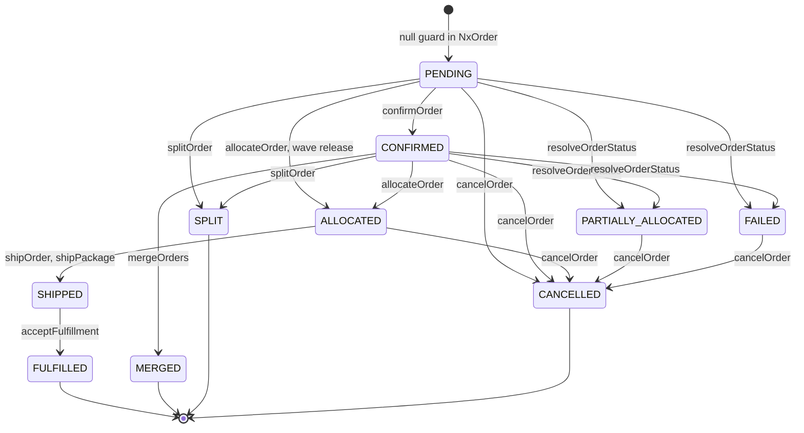

Verified details behind the edges:

- **Allocation outcomes.** `OrderRoutingService.resolveOrderStatus` maps the
  raw numbers: zero demand or full coverage → `ALLOCATED`; any shortfall →
  `PARTIALLY_ALLOCATED`, except a total miss against a backorder row →
  `FAILED`. `confirmOrder` skips its own `CONFIRMED` write when routing
  reported `PARTIALLY_ALLOCATED`/`FAILED` (T-17), so a short order survives
  confirmation in its honest state.
- **Who can split or merge.** `splitOrder` accepts only `PENDING` or
  `CONFIRMED` sources. `mergeOrders` rejects sources already `SHIPPED`,
  `DELIVERED` or `CANCELLED`. `MERGED` and `SPLIT` are terminal for the
  source — the work moves to the merged or split child record.
- **Cancellation.** `cancelOrder` has no status guard: it releases any
  reserved inventory, writes `CANCELLED`, pushes the status to BigCommerce
  and publishes `order.cancelled`.
- **The API escape hatch.** `PUT /orders/{id}/status`
  (`OrderService.updateStatus`) writes *any* string it is handed with no
  validation. That is the only way `DELIVERED`, `ON_HOLD`, `PICKING`,
  `PACKING` and `PACKED` ever land on an order, even though dashboard
  queries count them and no service `setStatus` call produces them. It is
  also how `APPROVED`/`RELEASED` — named by `WaveService.PICKABLE_STATES`
  as wave-eligible order statuses — can appear despite having no writer.

### Fulfillment Lifecycle

Three cooperating objects drive a confirmed order through the warehouse. Each
has its own status column, its own owning service and its own vocabulary.
They are deliberately **three diagrams, not one**: a single merged graph would
fuse their identically-named states (`IN_PROGRESS`, `COMPLETED`,
`CANCELLED`) into shared nodes and invent edges between objects that never
touch each other's status.

**Wave** — `nx_waves`, written only by `WaveService`:

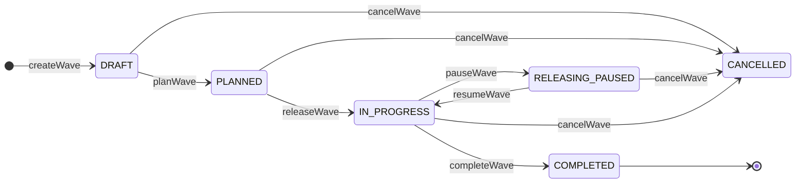

Every hop is guarded: `planWave` requires `DRAFT`, `releaseWave` requires
`PLANNED`, `pauseWave` and `completeWave` require `IN_PROGRESS`, `resumeWave`
requires `RELEASING_PAUSED`. `cancelWave` requires membership in
`ACTIVE_STATES` = `DRAFT`, `PLANNED`, `RELEASING`, `RELEASING_PAUSED`,
`RELEASED`, `IN_PROGRESS` — note that set names `RELEASING`/`RELEASED`,
values no writer ever produces.

**Pick list** — `nx_picklists`, written by `PickingService` and `WaveService`:

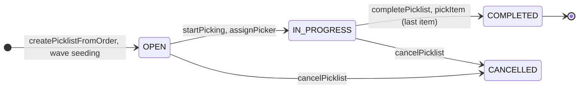

Pick **items** carry a separate three-value vocabulary written by the same
service: `PENDING` → `PICKED` (`pickItem`, `pickAllItems`,
`completePicklist`) or `PENDING` → `CANCELLED` (`cancelPicklist`, for items
not yet picked). `pickAllItems` leaves the list `IN_PROGRESS`; only
`completePicklist` or the auto-finish inside `pickItem` when the last item is
picked closes it. Neither the auto-finish nor `cancelPicklist` checks the
current list status.

**Package** — `nx_packages`, written only by `PackingService`:

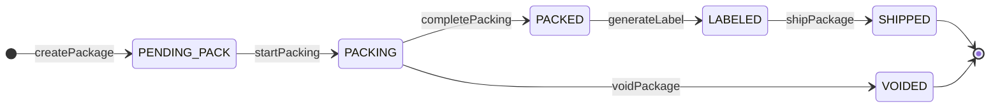

`voidPackage` performs no status check — it will run from any package state;
only the `PACKING` source is drawn. `shipPackage` additionally flips the
parent order's status to `SHIPPED` when the package is linked to an order.

Wave release writes `ALLOCATED` **on the orders** it seeds into the picklist
(`WaveService.seedItemsIntoPicklist`) — an order status, not a wave stage.

### Shipment Lifecycle

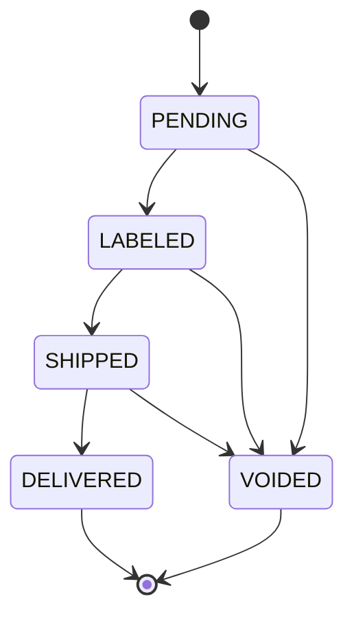

Carrier status webhooks land on `DELIVERED` and on the `VOIDED` path when a
label is cancelled before tender.

### Return Lifecycle

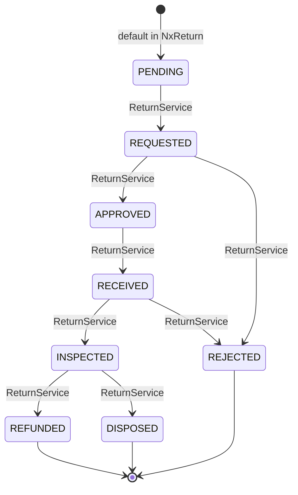

`REFUNDED` hands off to `ReturnFinanceService`, which settles against the
original payment method.

### Procurement Lifecycle

Procurement spans **three separate entities**, each defaulting to `DRAFT` via
a null guard and each written only by `ProcurementService`. Collapsing them
into one chain is the classic mistake this section exists to prevent — and
note `APPROVED` is shared by two *different* entities, so it must not appear
as a single node in a merged graph.

**PurchaseRequest**:

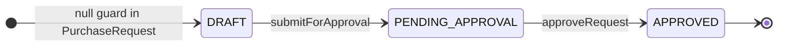

**Rfq**:

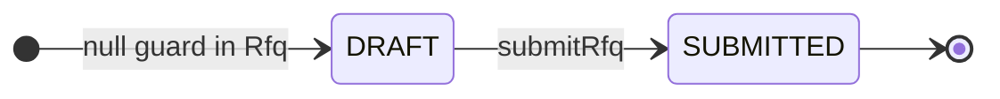

**PurchaseOrder**:

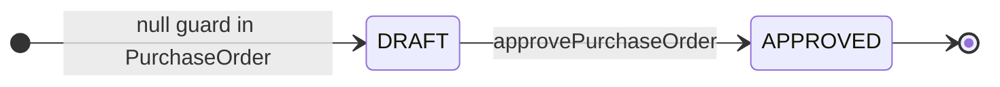

| Entity | Default status | Transitions found in source |
|---|---|---|
| `PurchaseRequest` | `DRAFT` | `PENDING_APPROVAL`, `APPROVED` |
| `Rfq` | `DRAFT` | `SUBMITTED` |
| `PurchaseOrder` | `DRAFT` | `APPROVED` |

That is the complete set: a repository-wide grep finds no other `setStatus`
call targeting these three entities — no reject, cancel, award or receive
transitions exist yet.

## Event Topology

All topic names are the literal constants in `kafka/Topics.java`. Every topic
has a paired dead-letter topic produced by `Topics.dlq(topic)`.

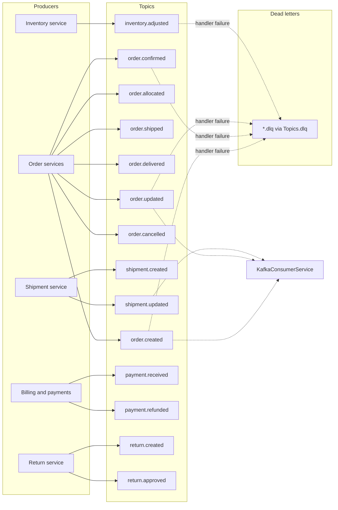

Consumption is funnelling through `KafkaConsumerService`; a `NoOpKafkaProducerService`
exists so the platform can run with Kafka disabled for local development.

> 🧒 **In plain words:** services do not call each other directly for
> order lifecycle work — they announce facts on topics, and anything that cannot
> handle the announcement drops it into a dead-letter topic instead of losing it.

## Frontend Architecture

```mermaid
flowchart TB
    main["main.tsx<br/>Vite entry point"]
    app["App.tsx<br/>router and layout shell"]

    subgraph src["nexus-oms-frontend/src"]
        pages["pages/<br/>one component per route"]
        components["components/<br/>shared UI"]
        api["api/<br/>module per resource"]
        hooks["hooks/<br/>data and effect hooks"]
        context["context/<br/>auth and tenant context"]
        types["types/"]
        utils["utils/"]
        styles["styles/, index.css"]
        rf["rf/"]
        test["test/"]
    end

    browser["Browser"] --> main --> app
    app --> pages
    pages --> components
    pages --> hooks
    hooks --> api
    context -.->|"current tenant and user"| app
    api -->|"fetch /api/v1"| backend["Backend API"]
```

Routes are declared in `App.tsx` and each page pulls data through exactly one
`api/` module — there is no second HTTP client. React is pinned to 18.3.1 across
the repo; see [README](../README.md) for the version table.

## Security Topology

Trust boundaries, outermost first:

```mermaid
flowchart TB
    subgraph untrusted["Untrusted"]
        internet((Internet))
        browser["Browser"]
    end

    subgraph edge["Edge, authenticated by TLS"]
        nginx["Nginx :80 / :443<br/>TLS, static assets"]
        hsec["SecurityHeadersFilter<br/>CSP with nonce, frame and referrer policy"]
        corr["CorrelationIdFilter<br/>request id on every log line"]
    end

    subgraph api["API, authenticated by token"]
        jwt["JwtAuthenticationFilter"]
        rate["RateLimitingFilter backed by Redis"]
        idem["IdempotencyFilter"]
        perm["PermissionAuthorizationFilter<br/>74 mapped permission paths"]
        wh["WebhookAuthenticationFilter<br/>HMAC verification"]
        imp["ImportTokenAuthenticationFilter<br/>X-Import-Token"]
        tenant["TenantContext<br/>row-level tenant scoping"]
    end

    subgraph internal["Internal, never exposed"]
        postgres[("PostgreSQL")]
        redis[("Redis")]
        kafka[("Kafka")]
        grafana["Grafana :3001"]
        prometheus["Prometheus :9090"]
    end

    internet --> nginx
    browser --> nginx
    nginx --> hsec --> corr --> jwt
    jwt --> rate --> idem --> perm --> tenant
    wh -.->|"signed, no bearer token"| jwt
    imp -.->|"import token"| jwt
    tenant --> postgres
    rate --> redis
    tenant -.->|"audit and trace"| kafka
    perm -.->|"authoritative allow / deny"| redis
```

Control notes:

- CORS is configured in `CorsConfig`; WebSocket endpoints are handled by
  `WebSocketConfig`.
- `TokenBlacklistService` lets a logout invalidate a token before its expiry.
- `TenantAwareDataSource` and `TenantContext` keep one tenant's rows invisible to
  another; the scoping happens below the service layer.
- Admin-only surfaces are the `/actuator/**` family, gated to role `ADMIN`.

## Appendix Re Deriving Diagrams

Every claim in this document can be regenerated. Run these from the repository
root.

```bash
# Status literals used by order-lifecycle services
grep -rhoE 'setStatus\("[A-Z_]+"\)' nexus-oms-backend/src/main/java \
  --include='*.java' | sed 's/setStatus("//;s/")//' | sort -u

# Statuses per owning service
for f in OrderService OrderRoutingService BrokeringService WaveService \
         PickingService PackingService ReturnService ProcurementService; do
  printf '%-24s ' "$f"
  grep -hoE 'setStatus\("[A-Z_]+"\)' \
    nexus-oms-backend/src/main/java/com/nexus/oms/service/$f.java \
    | sed 's/setStatus("//;s/")//' | tr '\n' ' '
  echo
done

# Kafka topic constants
grep -E 'public static final String' \
  nexus-oms-backend/src/main/java/com/nexus/oms/kafka/Topics.java

# Servlet filter ordering
grep -n '@Order\|class ' nexus-oms-backend/src/main/java/com/nexus/oms/filter/*.java

# Security chain assembly
grep -n 'addFilter\|requestMatchers' \
  nexus-oms-backend/src/main/java/com/nexus/oms/security/SecurityConfig.java

# Container service and port map
awk '/^  [a-z][a-z0-9_-]*:$/{svc=$1} /- "[0-9]+:[0-9]+"$/{print svc, $0}' \
  docker-compose.yml

# CI and CD job IDs
awk '/^jobs:/{f=1} f && /^  [a-z][a-z0-9_-]*:$/{print $1}' .github/workflows/ci.yml
awk '/^jobs:/{f=1} f && /^  [a-z][a-z0-9_-]*:$/{print $1}' .github/workflows/cd.yml

# Documentation truth gate, same command the docs CI job runs
python3 scripts/verify_docs.py --no-surefire
```

If any of these return something different from the diagrams above, the diagram
is stale and this document should be updated in the same commit as the source
change.

---

*Companion to the Nexus documentation set — see [docs index](./README.md).*
